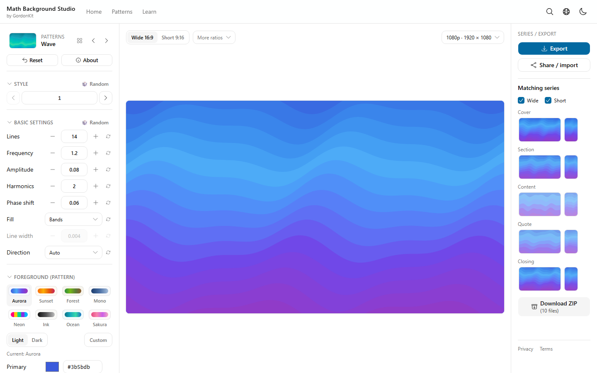
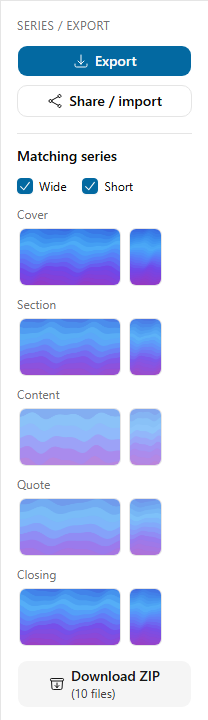
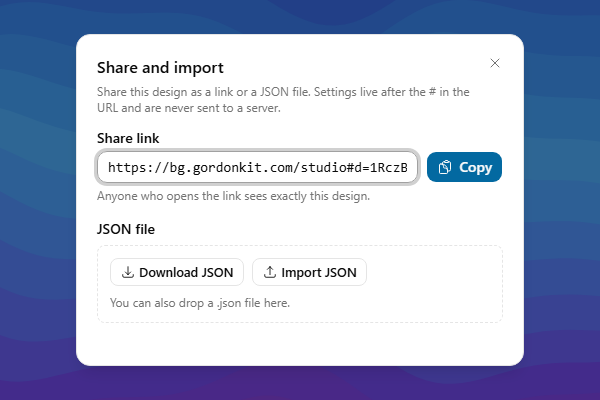
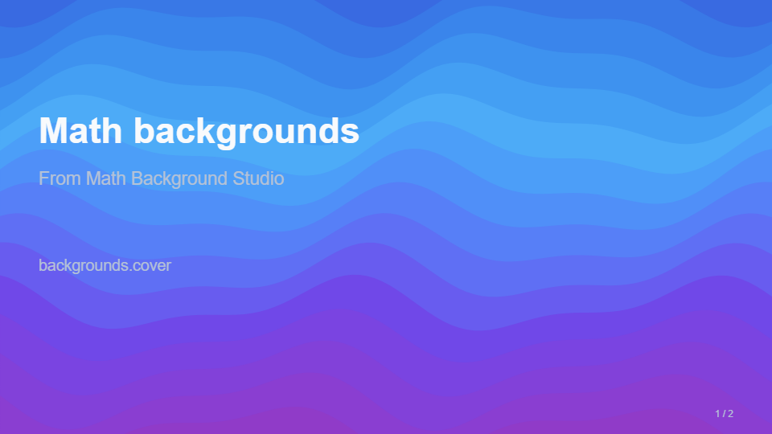
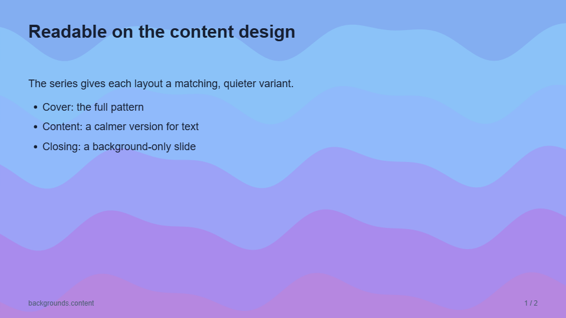
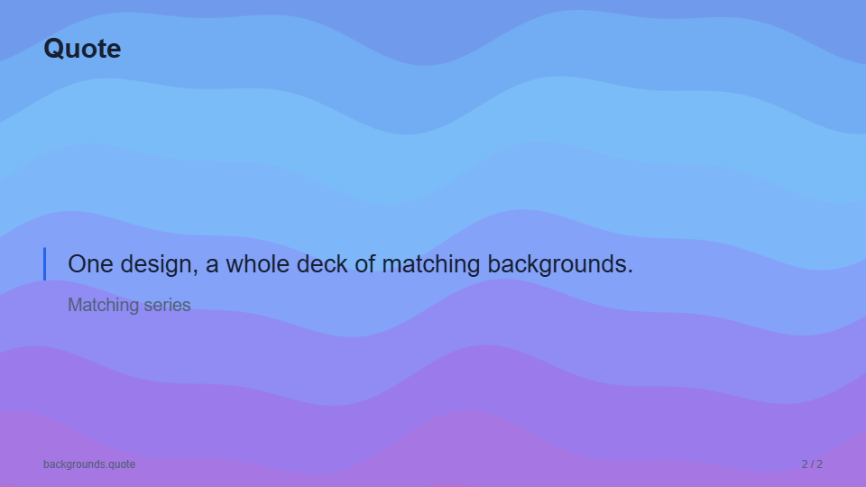

# Backgrounds with Math Background Studio

[Math Background Studio](https://bg.gordonkit.com/studio) (`bg.gordonkit.com`) is a
free, browser-based GordonKit tool that draws backgrounds from mathematical patterns:
waves, roses, flow fields, Voronoi cells, and more. A design is stored entirely in its
share link, and SlideForge accepts that link wherever it accepts a background image.
At preview and export the studio's `/render` page draws the design at the slide's
1920 × 1080 size, and export places the result in each slide's PowerPoint background.

This guide walks through the workflow. The field rules are in
[schema](schema.md#backgrounds); how export captures the layer is in
[architecture](architecture.md#slide-backgrounds).

## 1. Design a background

Open <https://bg.gordonkit.com/studio>. Pick a pattern, a style, and a palette on the
left; the preview in the middle shows the design. Keep **Wide 16:9** selected, the
slide's shape. A design is never stretched to fit: the studio re-composes it for the
other ratio instead.



## 2. Pick matching designs for each layout

**Matching series** on the right derives five related designs from the current one:
Cover, Section, Content, Quote, and Closing. The Content and Quote designs are calmer
versions meant to sit behind text. Click a design (its button is named, for example,
"Edit Content (Wide)") to load it into the editor, then share it as in the next step.



## 3. Copy the share link

Click **Share / import**, then **Copy**. The link looks like
`https://bg.gordonkit.com/studio#d=1RcZ…`. Everything after `#d=` is the design; browsers
do not send the hash to the server.



## 4. Use the links in the presentation

Paste each link as a background source. `backgrounds` applies one per layout family
(or `family/variant`) for the whole deck, and a slide's own `background` overrides it:

```json
{
  "metadata": { "title": "Math backgrounds" },
  "theme": "dark",
  "backgrounds": {
    "cover": "https://bg.gordonkit.com/studio#d=…cover…",
    "content": "https://bg.gordonkit.com/studio#d=…content…",
    "quote": "https://bg.gordonkit.com/studio#d=…quote…",
    "blank": "https://bg.gordonkit.com/studio#d=…closing…"
  },
  "slides": [
    { "layout": "cover", "title": "Math backgrounds" },
    {
      "layout": "content",
      "title": "Agenda",
      "blocks": [
        { "type": "bullets", "items": ["One", "Two"] }
      ]
    },
    {
      "layout": "quote",
      "title": "Quote",
      "quote": "One design, many matching backgrounds."
    },
    { "layout": "blank", "title": "Closing" }
  ]
}
```

A sensible mapping from the series to layout families:

| Series design | Background key |
| --- | --- |
| Cover | `cover` |
| Section | a `content` or `cards` slide that opens a section, through its own `background` |
| Content | `content`, `two-columns`, `cards`, `timeline`, `gantt`, `table`, `chart` |
| Quote | `quote` |
| Closing | `blank` |

Put the links in a [template](templates.md)'s `backgrounds` instead to reuse them
across decks.

## 5. Preview and export

`preview` and `export` load the studio's `/render` page for each link. Text contrast
against a background is not checked, so choose the theme for the design: these slides
use the dark theme (light text) on the saturated cover and closing designs, and the
light theme (dark text) on the calmer content and quote designs.

| | |
| --- | --- |
|  |  |
|  |  |

The last slide uses the `blank` layout, which draws only its background: no title,
content, footer, or slide number. Use it for a full-bleed opening, section break, or
closing image. Its `title` still names the slide (its accessible label) but is not drawn, and its
`notes` become speaker notes.

## Things to know

- Preview and export need network access to `https://bg.gordonkit.com` and run the
  studio's page scripts. Only links from that origin, or from a `localhost`,
  `127.0.0.1`, or `[::1]` studio development server, are accepted.
- Each background becomes a 1920 × 1080 PNG in the slide's PowerPoint background. It can
  be replaced in PowerPoint, but the pattern itself is not editable there.
- The pixels depend on the studio version and the Chromium build, so the same link can
  look slightly different over time. For a deck that must be reproducible offline,
  click **Export** in the studio, save a PNG or SVG next to the JSON, and use its relative
  path instead of the link.

See [limitations](limitations.md#backgrounds) for the full list.

## Screenshots

The screenshots in this guide and in [components](components.md#layout-gallery) are
generated by `npm run docs:screenshots` (after `npm run build`), which renders the slides
with SlideForge and opens the live studio in English. It needs network access to
`bg.gordonkit.com`, and the result depends on the installed fonts and the studio's
current version.
