# Component and layout reference

Components are React 19 functions exported from the package root. They emit
markup only; `renderPresentation` supplies the document, stylesheet, palette,
font, and fixed canvas. Direct component use must provide the corresponding
CSS/theme context. Components themselves do not perform schema validation.

## Public components

| Component | Props | Output |
| --- | --- | --- |
| `Slide` | `{ slide: PresentationSlide; variant?: string; number: number; total: number; background?: string; children: ReactNode }` | Full slide frame, background layer, title/content/footer/notes |
| `SlideBackground` | `{ source: string }` | `.sf-background[data-pptx-background]` layer: an ``, or a studio `/render` `<iframe>` for a share link |
| `SlideTitle` | `{ title: string; subtitle?: string }` | `.sf-header`, `h1`, optional `.sf-subtitle` |
| `SlideSubtitle` | `{ children: ReactNode }` | `.sf-subtitle` paragraph |
| `SlideContent` | `{ children: ReactNode }` | `.sf-content` content region |
| `SlideCard` | `{ title: string; children: ReactNode }` | `.sf-card` article with `h2` |
| `SlideColumns` | `{ children: ReactNode }` | Equal two-column `.sf-columns` grid |
| `SlideFooter` | `{ text?: string; number: number; total: number }` | `.sf-footer`, optional text and `number / total` |
| `SlideFrame` | Same as `Slide` | Alias of `Slide` |
| `ContentBlocks` | `{ blocks: ContentBlock[] }` | `.sf-blocks`, paragraphs, ordered/unordered lists, image figures/captions |
| `SlideImage` | `{ src: string; alt: string; caption?: string }` | Image figure and optional caption |
| `SlideTable` / `DataTable` | `{ columns: string[]; rows: string[][] }` | Semantic HTML table with column headers; `DataTable` is an alias |
| `SlideChart` / `BarChart` | `{ data: { label: string; value: number }[]; unit?: string }` | HTML/CSS horizontal bars, text labels/values, accessible chart summary; `BarChart` is an alias |

`number` is one-based. `Slide` / `SlideFrame` emits
`.sf-slide.sf-layout-<family>.sf-variant-<variant>`, `data-pptx="slide"`,
`data-layout="<family>"`, `data-variant="<variant>"`, and an accessible slide label.
`variant` defaults to the one the slide's `layout` names, or `default` for a bare
family name. Notes are
emitted in a hidden `<aside data-pptx-notes="">`; the converter extracts them as
speaker notes. A slide's `author` and presentation metadata `author` are separate.
`background` is the resolved source (see `slideBackground` in [schema](schema.md#backgrounds));
when present, `SlideBackground` is the slide's first child, behind the content.

`ContentBlocks` renders plain text through React escaping, not Markdown or raw
HTML. Images use `object-fit: contain` and require `alt` in structured input.
Ordered lists default to off. `DataTable` expects matching row/column lengths;
the JSON schema enforces this before the normal rendering path.

`BarChart` scales widths against `max(largest value, 1)`; all-zero data produces
zero-width bars. Values are displayed directly with the unit appended. These
are CSS rectangles and text, **not native PowerPoint chart objects**, with no
editable chart workbook/series API.

## Layout dispatcher

`SlideLayout` in `src/layouts/index.tsx` is internal, not exported from the
package root. It looks up the slide's family in a renderer table and composes
the result with `Slide`. Each family lives in `src/layouts/<family>/` with its
schema, renderer, and stylesheet, and is listed in `src/layouts/registry.ts`:

| Layout | Composition |
| --- | --- |
| `cover` | Enlarged title/subtitle and optional author; `split` adds an `aria-hidden` `.sf-cover-panel` |
| `content` | One `ContentBlocks` stack |
| `two-columns` | Two equal-width `ContentBlocks` stacks |
| `cards` | `.sf-cards[data-count]` grid of 1–6 titled cards, arranged by their count |
| `timeline` | `ol.sf-timeline` with one column per event: date, an `aria-hidden` marker on a rail, title, and optional text |
| `gantt` | `.sf-gantt` rows on one grid: a period header, then per task a label (and progress) and a `role="img"` track holding its bar |
| `table` | `SlideTable` |
| `chart` | `SlideChart`, optionally beside explanatory `ContentBlocks` |
| `quote` | `figure.sf-quote` with the quote in a `blockquote` and the attribution in a `figcaption` |
| `blank` | Nothing: `Slide` leaves out the title, content region, and footer, so only the background is drawn |

See [schema](schema.md) for exact field names and bounds and
[design tokens](design-tokens.md) for sizes.

The timeline's rail and markers sit inside a `data-pptx-allow-overlap="true"` track,
since the marker is drawn over the rail on purpose, and each gantt bar sits in a
track marked the same way. All of them export as editable shapes.

## Layout gallery

Each layout and variant in the light theme with the built-in tokens. A template or the
dark theme changes the colors and sizes, not the arrangement. The screenshots are
generated by `npm run docs:screenshots`; see [backgrounds](backgrounds.md#screenshots).

### `cover`

| `cover` (`default`) | `cover/centered` |
| --- | --- |
| 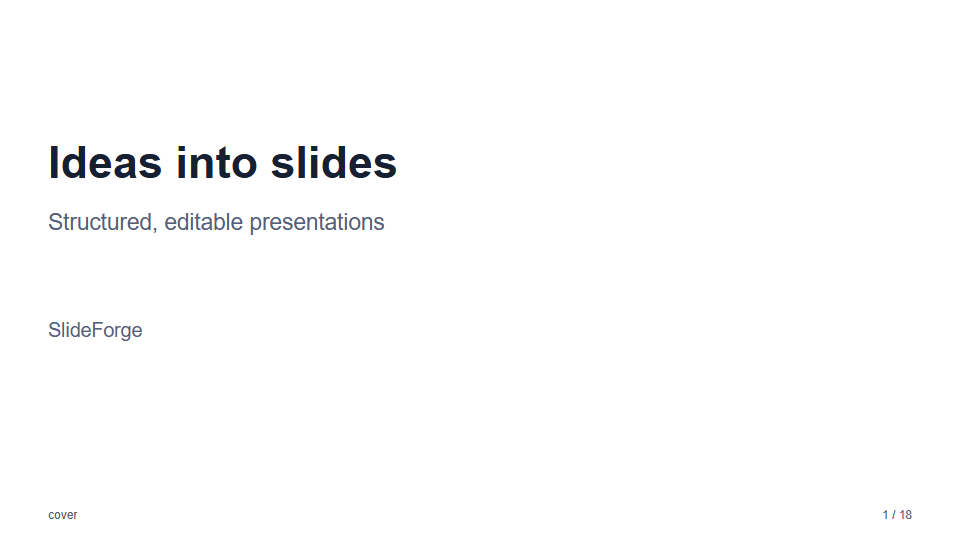 | 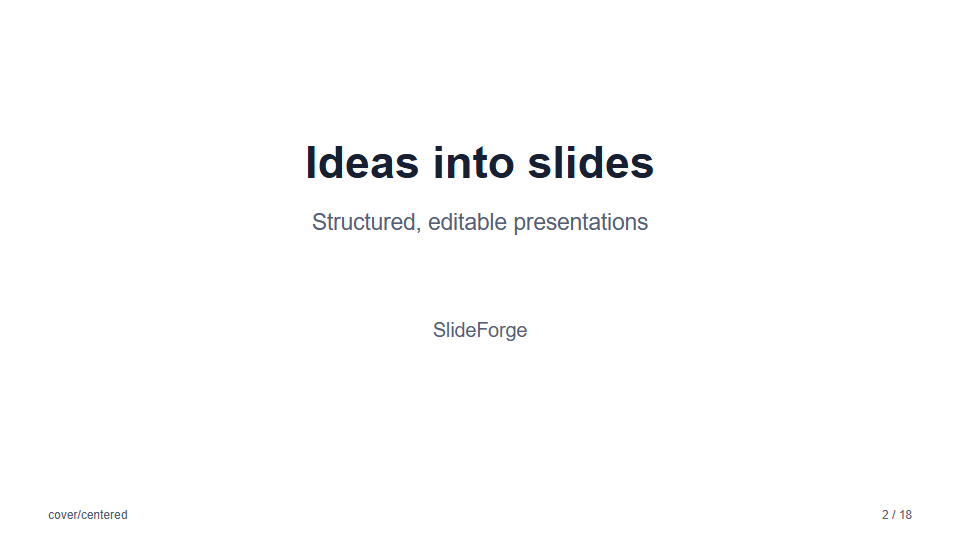 |
| **`cover/split`** | **`cover/band`** |
| 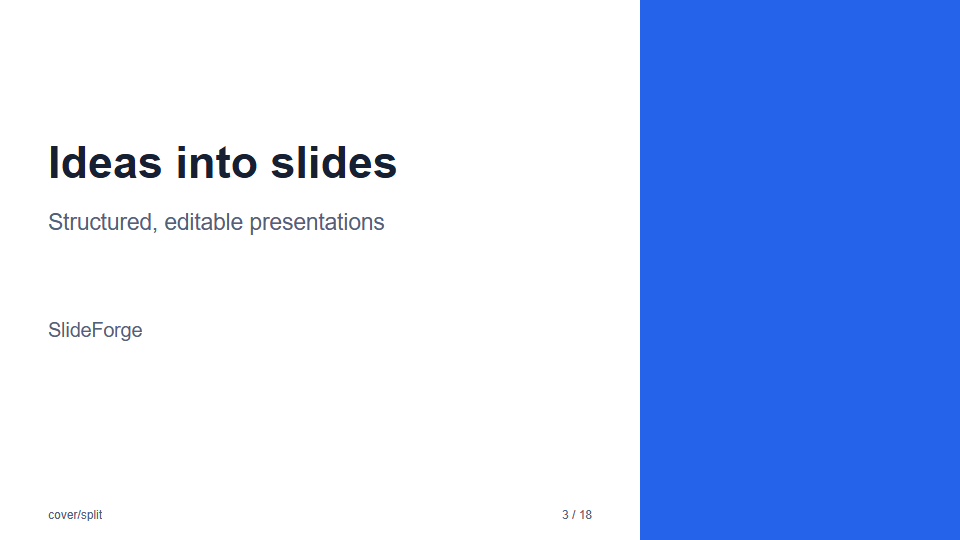 | 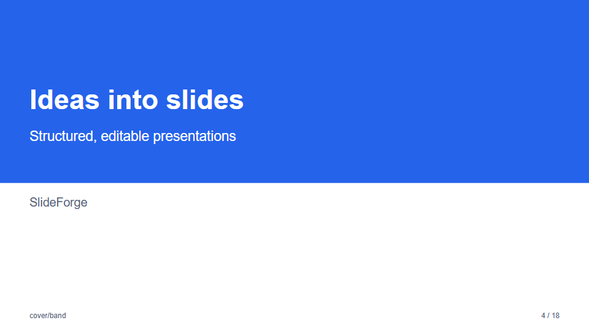 |

### `content` and `two-columns`

| `content` | `two-columns` |
| --- | --- |
| 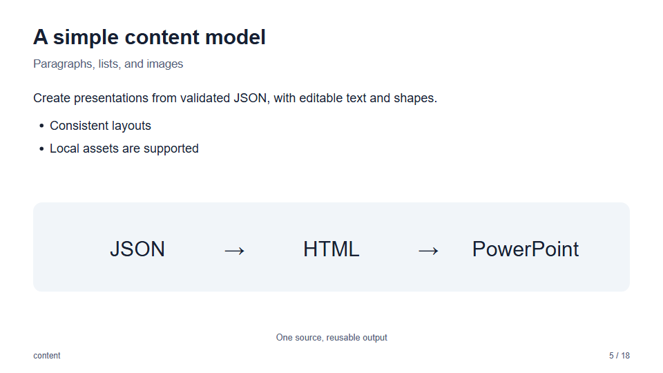 | 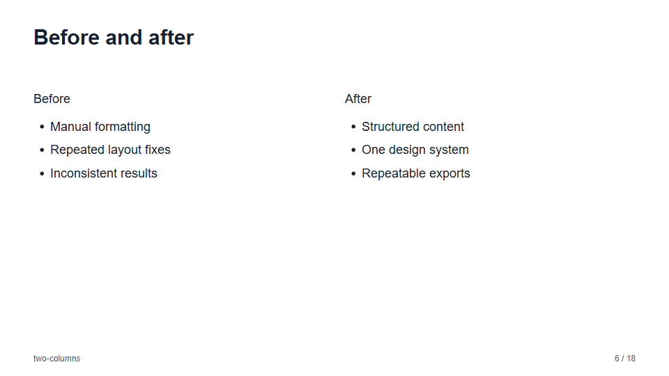 |

### `cards`

The grid follows the number of cards: one card spans the width, two sit side by side,
three and six use three columns, four form a 2 × 2 grid, and five are three over two.

| 2 cards | 3 cards |
| --- | --- |
| 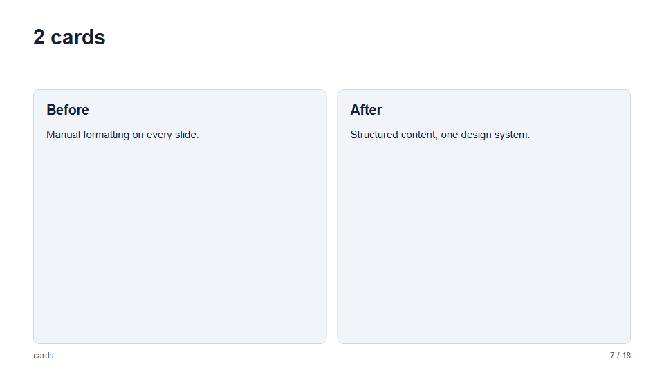 | 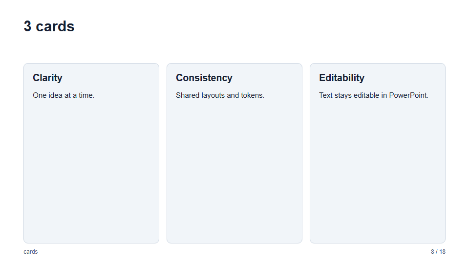 |
| **4 cards** | **5 cards** |
| 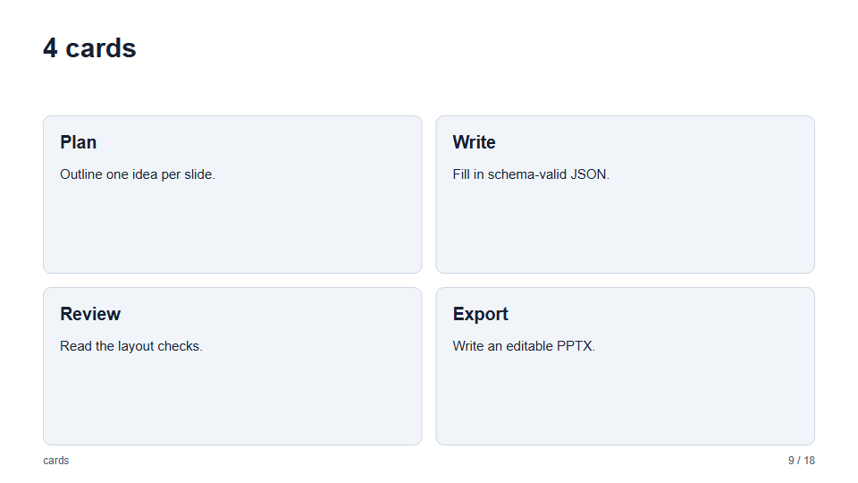 | 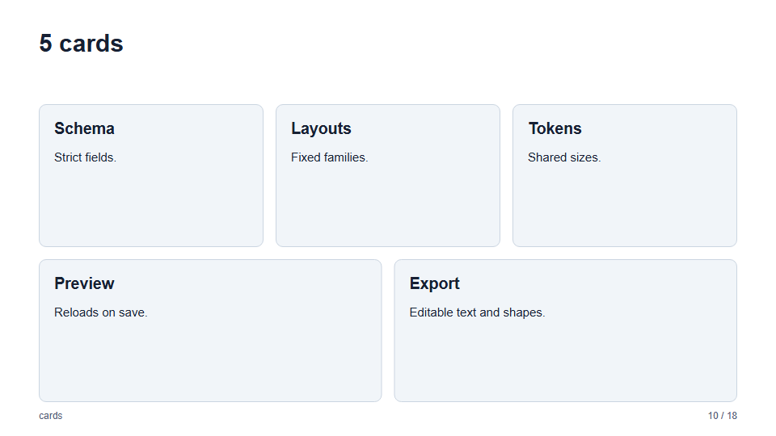 |
| **6 cards** | |
| 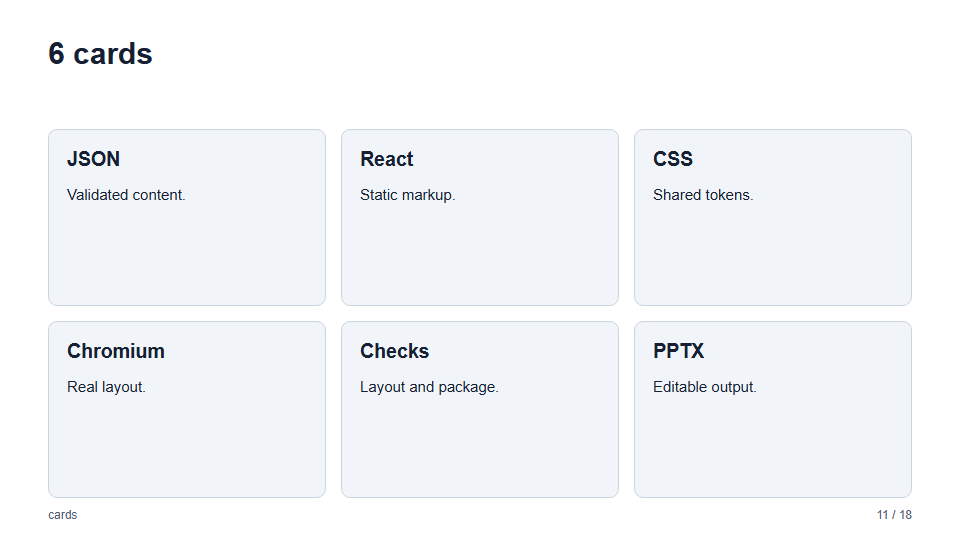 | |

### `timeline`

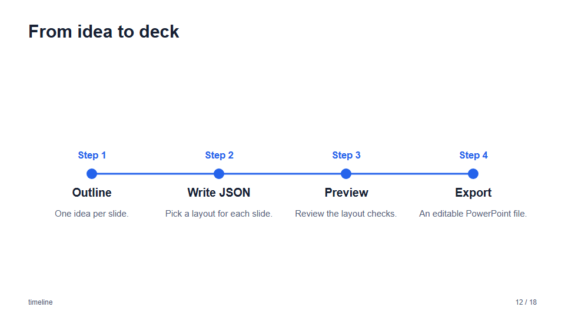

### `gantt`

A project schedule: tasks as bars over labeled periods, with optional progress.

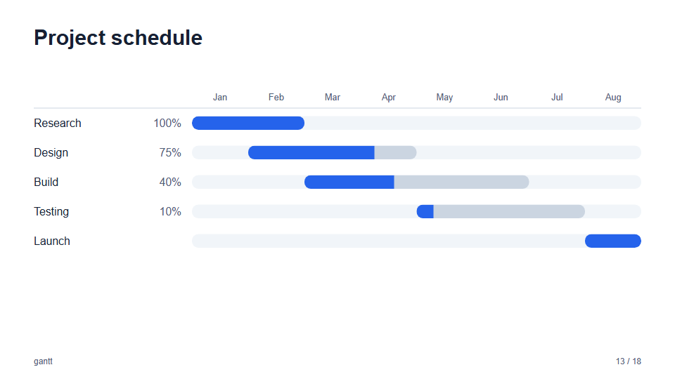

### `table` and `chart`

| `table` | `chart` |
| --- | --- |
| 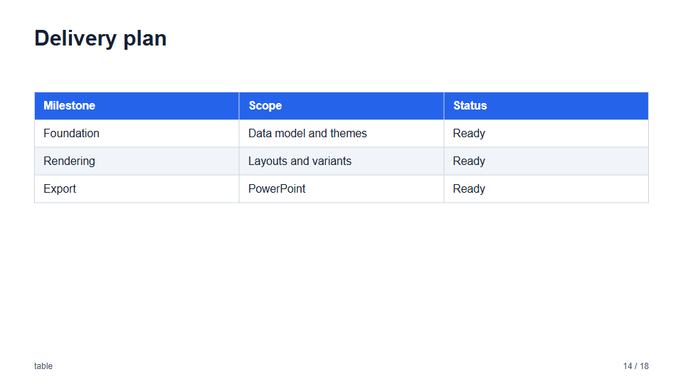 | 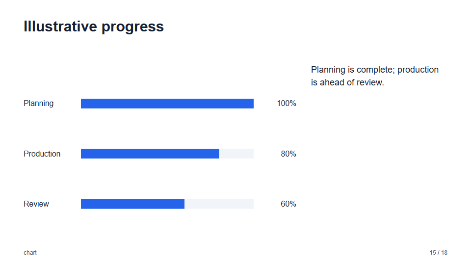 |

### `quote`

| `quote` (`default`) | `quote/centered` |
| --- | --- |
| 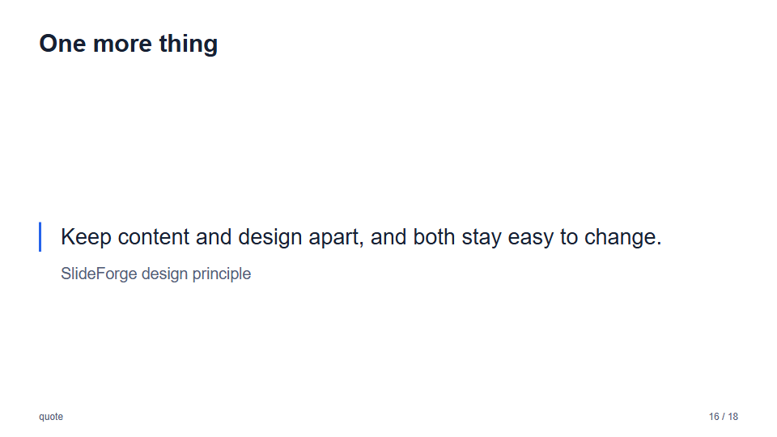 | 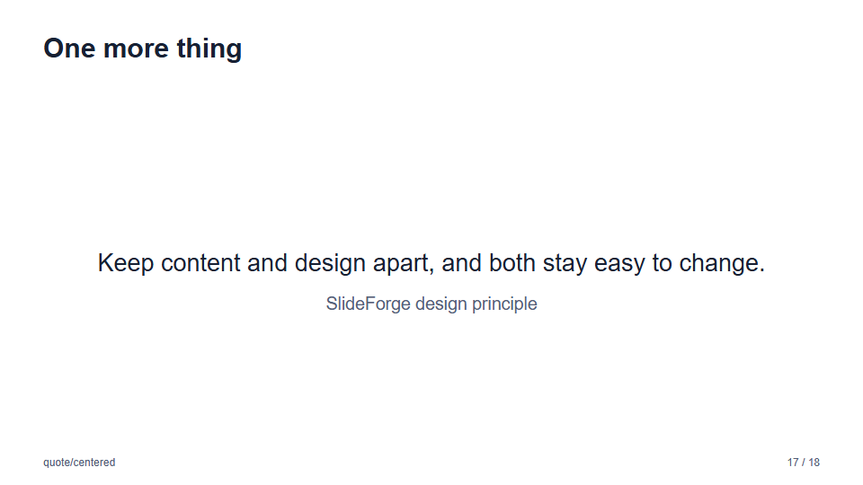 |

### `blank`

A blank slide shows only its background, here a
[Math Background Studio](backgrounds.md) design. Without a background it is an empty
slide in the theme's color.

## Custom trusted HTML

For custom export input, give each slide a fixed 1920 × 1080 box and mark it with
`data-pptx="slide"` or `.slide`; alternatively pass `--selector`. Keep text and
simple fills/borders as DOM/CSS when editability matters. Upstream may rasterize
some effects or media. SlideForge does not provide automatic screenshot fallback
for arbitrary unsupported content.

Intentional decorative overlap may be marked
`data-pptx-allow-overlap="true"` on a containing element to exclude its descendants
from the overlap heuristic. This does not suppress overflow, bounds, or missing
asset checks. Prefer changing layout over suppressing diagnostics.

A full-slide background in custom HTML is a direct child of the slide marked
`data-pptx-background`, sized to the whole slide and painted behind the content,
for example `
`
containing an `` or a studio `/render` `<iframe>` (the slide needs
`isolation: isolate` or its own stacking context). Export captures that layer as
the slide's PowerPoint background, as described in
[architecture](architecture.md#slide-backgrounds). A CSS `background-image` on the
slide itself is not converted; the converter drops it.
