# Component and layout reference

Components are React 19 functions exported from the package root. They emit
markup only; `renderPresentation` supplies the document, stylesheet, palette,
font, and fixed canvas. Direct component use must provide the corresponding
CSS/theme context. Components themselves do not perform schema validation.

## Public components

| Component | Props | Output |
| --- | --- | --- |
| `Slide` | `{ slide: PresentationSlide; variant?: string; number: number; total: number; background?: string; children: ReactNode }` | Full slide frame, background layer, title/content/footer/notes |
| `SlideBackground` | `{ source: string }` | `.sf-background[data-pptx-background]` layer: an ``, or a studio `/render` `<iframe>` for a share link |
| `SlideTitle` | `{ title: string; subtitle?: string }` | `.sf-header`, `h1`, optional `.sf-subtitle` |
| `SlideSubtitle` | `{ children: ReactNode }` | `.sf-subtitle` paragraph |
| `SlideContent` | `{ children: ReactNode }` | `.sf-content` content region |
| `SlideCard` | `{ title: string; children: ReactNode }` | `.sf-card` article with `h2` |
| `SlideColumns` | `{ children: ReactNode }` | Equal two-column `.sf-columns` grid |
| `SlideFooter` | `{ text?: string; number: number; total: number }` | `.sf-footer`, optional text and `number / total` |
| `SlideFrame` | Same as `Slide` | Alias of `Slide` |
| `ContentBlocks` | `{ blocks: ContentBlock[] }` | `.sf-blocks`, paragraphs, ordered/unordered lists, image figures/captions |
| `SlideImage` | `{ src: string; alt: string; caption?: string }` | Image figure and optional caption |
| `SlideTable` / `DataTable` | `{ columns: string[]; rows: string[][] }` | Semantic HTML table with column headers; `DataTable` is an alias |
| `SlideChart` / `BarChart` | `{ data: { label: string; value: number }[]; unit?: string }` | HTML/CSS horizontal bars, text labels/values, accessible chart summary; `BarChart` is an alias |

`number` is one-based. `Slide` / `SlideFrame` emits
`.sf-slide.sf-layout-<family>.sf-variant-<variant>`, `data-pptx="slide"`,
`data-layout="<family>"`, `data-variant="<variant>"`, and an accessible slide label.
`variant` defaults to the one the slide's `layout` names, or `default` for a bare
family name. Notes are
emitted in a hidden `<aside data-pptx-notes="">`; the converter extracts them as
speaker notes. A slide's `author` and presentation metadata `author` are separate.
`background` is the resolved source (see `slideBackground` in [schema](schema.md#backgrounds));
when present, `SlideBackground` is the slide's first child, behind the content.

`ContentBlocks` renders plain text through React escaping, not Markdown or raw
HTML. Images use `object-fit: contain` and require `alt` in structured input.
Ordered lists default to off. `DataTable` expects matching row/column lengths;
the JSON schema enforces this before the normal rendering path.

`BarChart` scales widths against `max(largest value, 1)`; all-zero data produces
zero-width bars. Values are displayed directly with the unit appended. These
are CSS rectangles and text, **not native PowerPoint chart objects**, with no
editable chart workbook/series API.

## Layout dispatcher

`SlideLayout` in `src/layouts/index.tsx` is internal, not exported from the
package root. It looks up the slide's family in a renderer table and composes
the result with `Slide`. Each family lives in `src/layouts/<family>/` with its
schema, renderer, and stylesheet, and is listed in `src/layouts/registry.ts`:

| Layout | Composition |
| --- | --- |
| `cover` | Enlarged title/subtitle and optional author; `split` adds an `aria-hidden` `.sf-cover-panel` |
| `agenda` | `ol.sf-agenda` of numbered rows: a number circle, a title, optional text, and an arrow; a row with a target slide is an `a[data-sf-link]`; `outline` puts a `ul.sf-agenda-subs` of subsections under each chapter |
| `section` | A chapter divider: `.sf-section-number` (`01`, `02`, … by slide order) beside the title and subtitle; `default` adds an `aria-hidden` `.sf-section-rail` |
| `content` | One `ContentBlocks` stack |
| `two-columns` | Two equal-width `ContentBlocks` stacks |
| `cards` | `.sf-cards[data-count]` grid of 1–6 titled cards, arranged by their count |
| `panels` | `.sf-panels[data-count]` of 2–7 `.sf-panel` sections (number, title, blocks) with an `aria-hidden` `.sf-panel-line` between them; a panel with a color is `.sf-panel-filled` |
| `timeline` | `ol.sf-timeline` with one column per event: date, an `aria-hidden` marker on a rail, title, and optional text |
| `gantt` | `.sf-gantt` rows on one grid: a period header, then per task a label (and progress) and a `role="img"` track holding its bar |
| `table` | `SlideTable` |
| `chart` | `SlideChart`, optionally beside explanatory `ContentBlocks` |
| `quote` | `figure.sf-quote` with the quote in a `blockquote` and the attribution in a `figcaption` |
| `blank` | Nothing: `Slide` leaves out the title, content region, and footer, so only the background is drawn |

See [schema](schema.md) for exact field names and bounds and
[design tokens](design-tokens.md) for sizes.

The timeline's rail and markers sit inside a `data-pptx-allow-overlap="true"` track,
since the marker is drawn over the rail on purpose, and each gantt bar sits in a
track marked the same way. All of them export as editable shapes.

## Layout gallery

Each layout and variant in the light theme with the built-in tokens. A template or the
dark theme changes the colors and sizes, not the arrangement. The screenshots are
generated by `npm run docs:screenshots`; see [backgrounds](backgrounds.md#screenshots).

### `cover`

| `cover` (`default`) | `cover/centered` |
| --- | --- |
| 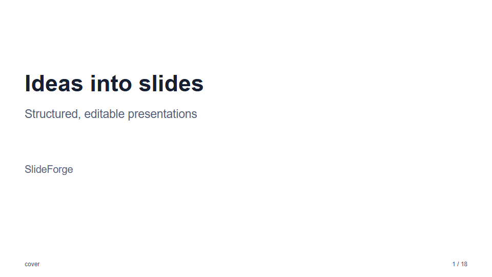 | 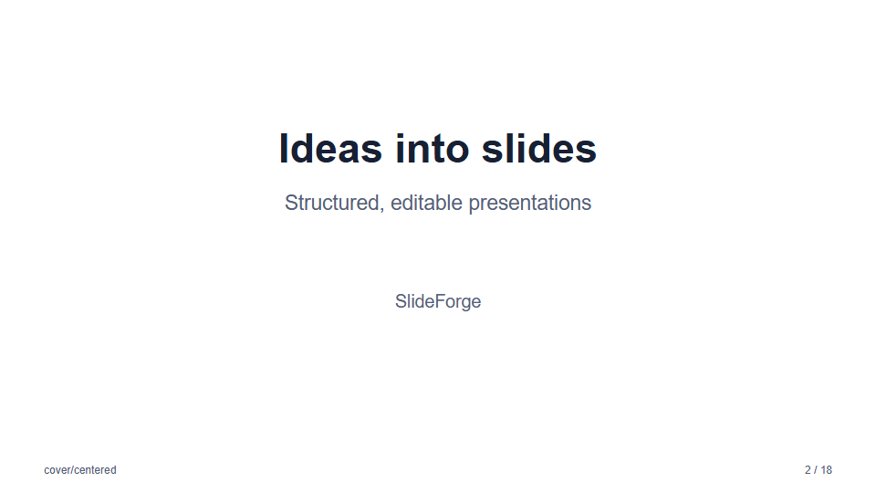 |
| **`cover/split`** | **`cover/band`** |
| 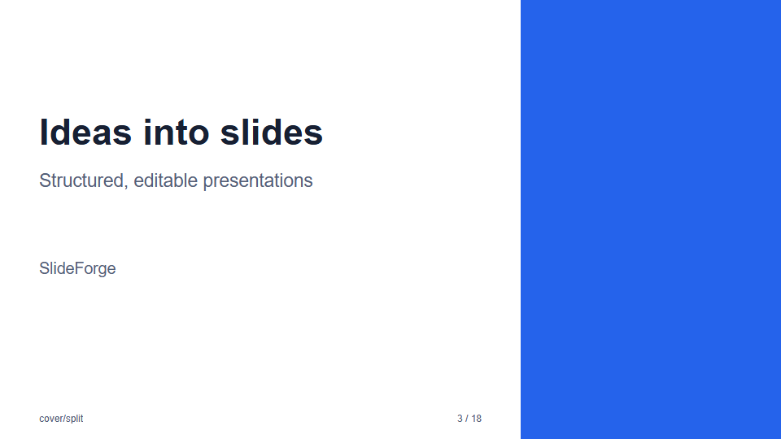 | 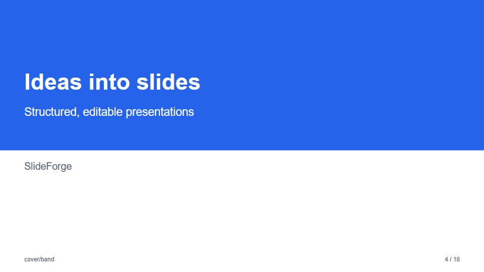 |

### `content` and `two-columns`

| `content` | `two-columns` |
| --- | --- |
| 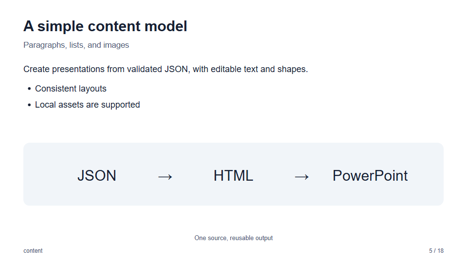 | 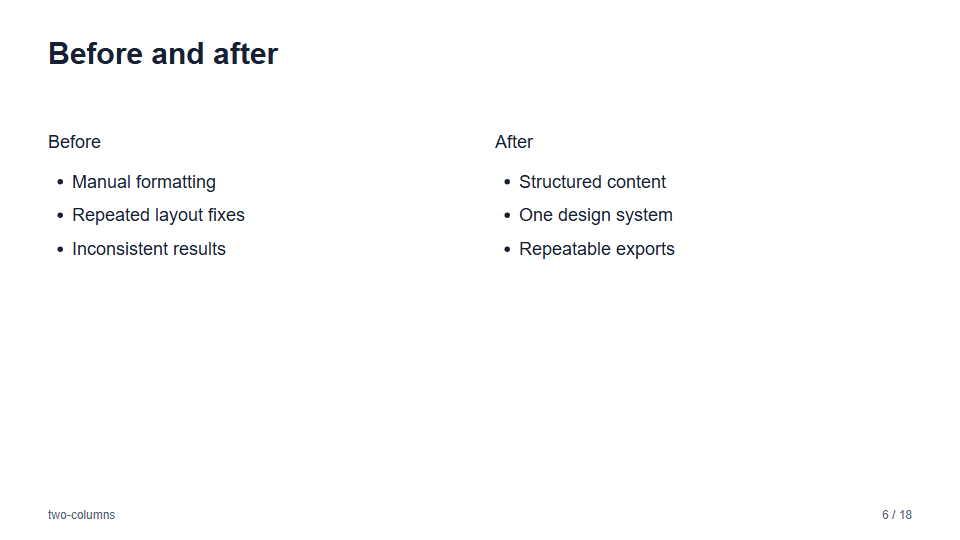 |

### `cards`

The grid follows the number of cards: one card spans the width, two sit side by side,
three and six use three columns, four form a 2 × 2 grid, and five are three over two, with the lower two keeping the upper cards' width and centered.

| 2 cards | 3 cards |
| --- | --- |
| 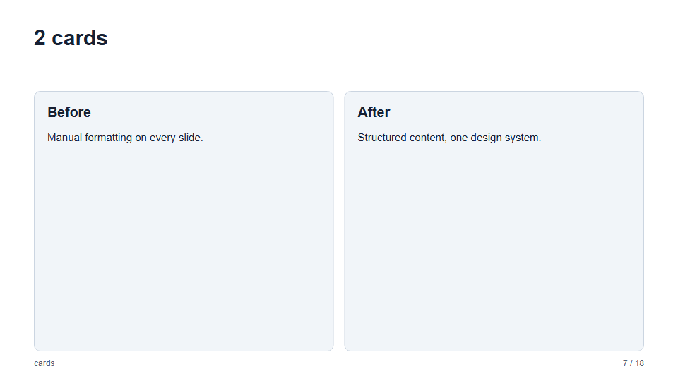 | 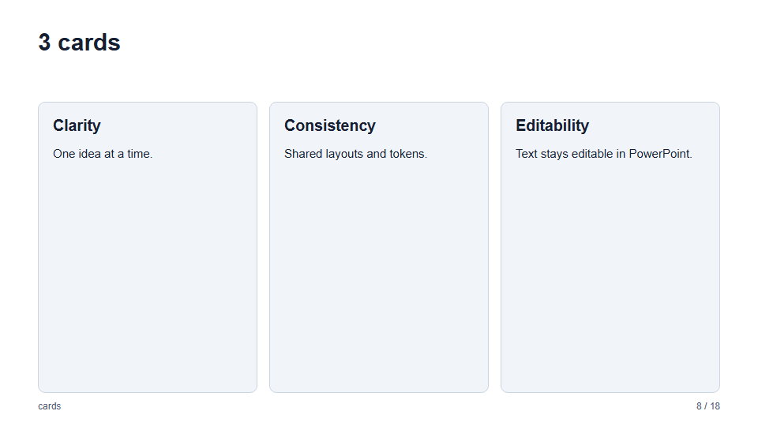 |
| **4 cards** | **5 cards** |
| 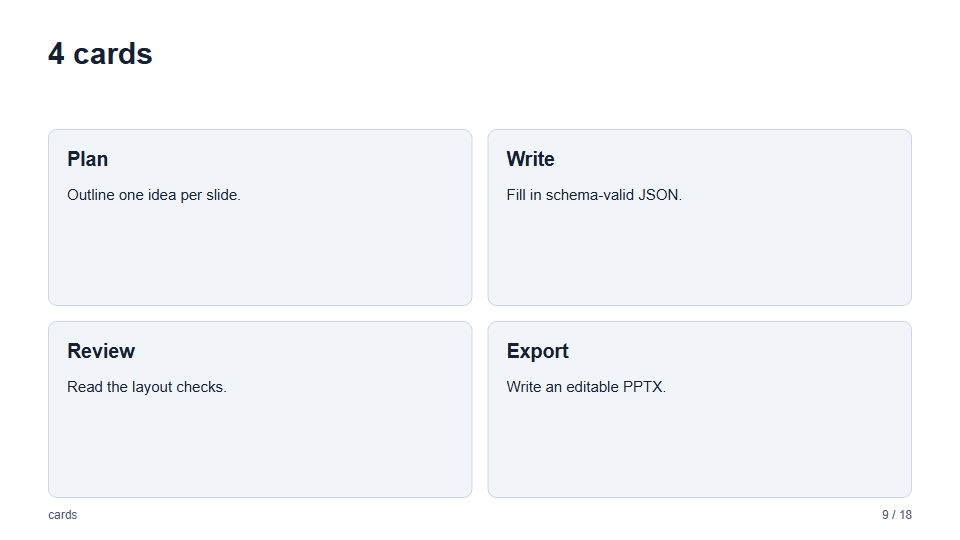 | 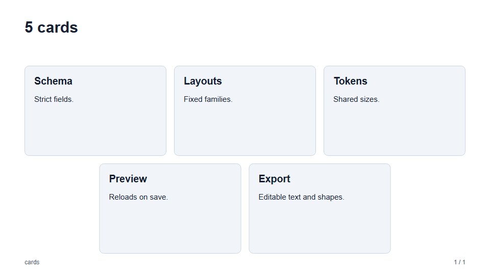 |
| **6 cards** | |
| 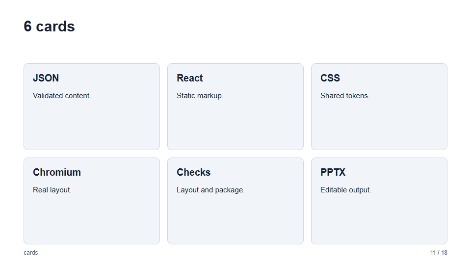 | |

Five variants change only the card shape; the fields and the grid are the same. `badge` keeps the
rectangular card and puts a numbered accent circle above its centered text. `circle`, `hexagon`, and
`pentagon` fill the whole card with an accent-colored regular shape, number the cards 1 to 6, and
center their text. These shapes keep their proportions, so they leave room above and below (or at the
sides) instead of stretching, and their text area is small: they suit a title and one or two short
lines.

| `cards/rounded` | `cards/badge` |
| --- | --- |
| 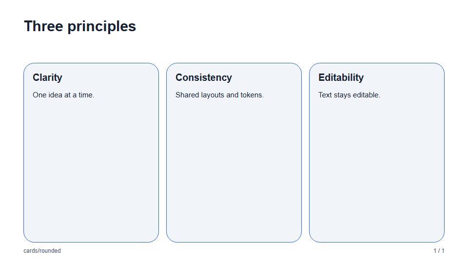 |  |
| **`cards/circle`** | |
| 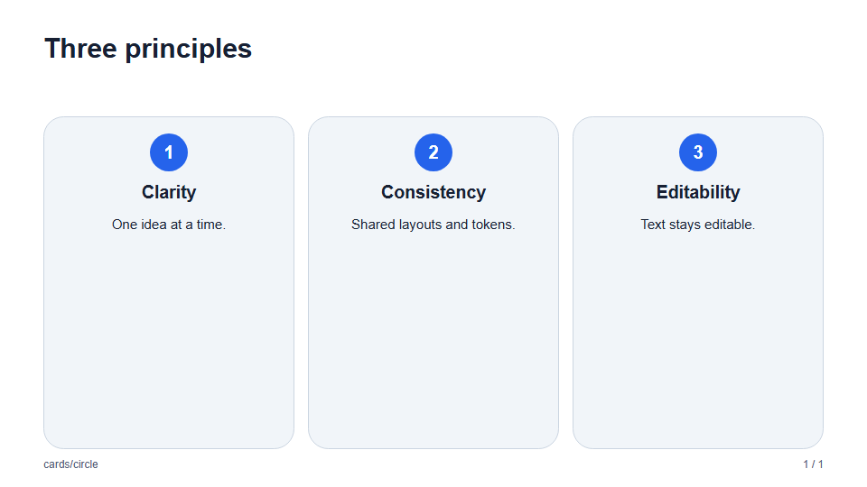 | |
| **`cards/hexagon`** | **`cards/pentagon`** |
| 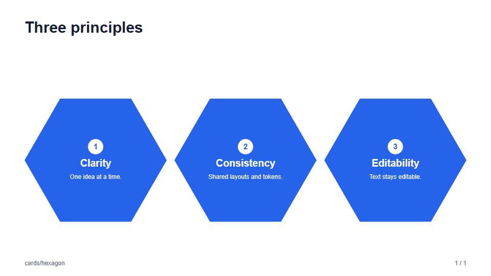 | 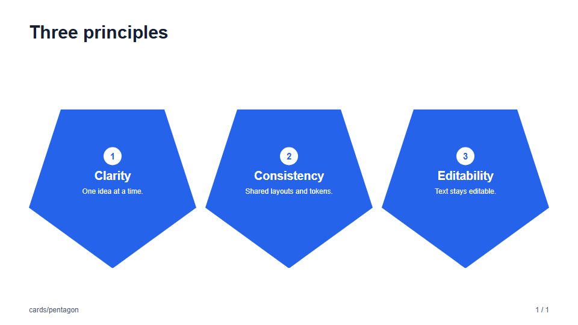 |

In PowerPoint the cards and circles are native shapes, and the polygons are native too: the hexagon and pentagon are
editable freeform shapes behind the text, and the text and number stay editable.

### `agenda`

An agenda lists two to eight topics as numbered rows: a number circle, a title, and optional text. Give an
item `slide` (the 1-based number of another slide) to make the row a link. A linked row ends with an
arrow and jumps to that slide.

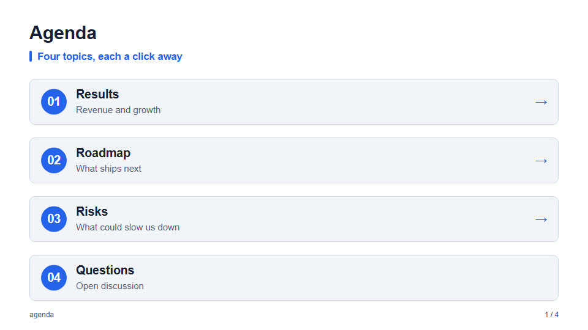

```json
{
  "layout": "agenda",
  "title": "Agenda",
  "subtitle": "Four topics, each a click away",
  "items": [
    { "title": "Results", "text": "Revenue and growth", "slide": 2 },
    { "title": "Questions" }
  ]
}
```

- **In HTML:** the row is an anchor to the slide (`#slide-2`). In `present` mode (and a build made with
  `--present`) a click jumps to it; a plain built file has no scripts, so it relies on the browser's
  anchor, which an asset base URL would resolve against that base.
- **In PowerPoint:** each linked row (its box, number, text, and arrow) is a "go to slide" button
  (`ppaction://hlinksldjump`), so clicking it in slide show, or Ctrl+click in editing, jumps to the
  target. The text keeps its design: it is not recolored or underlined like a text hyperlink.
- **Checks:** a `slide` that is less than 1 or larger than the number of slides is rejected. The
  link follows the slide's position, so renumber `slide` when you insert or reorder slides.
- **Layout:** up to four items are rows; five to eight are two columns. Keep titles short, and use
  `text` for a few words.

An agenda for a long deck has three variants, and the same `items` work in each of them:

| `agenda/chapters` | `agenda/outline` |
| --- | --- |
| 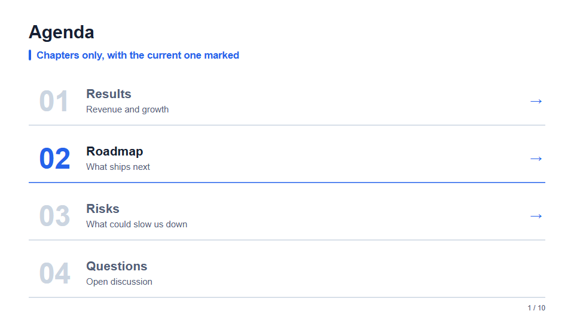 | 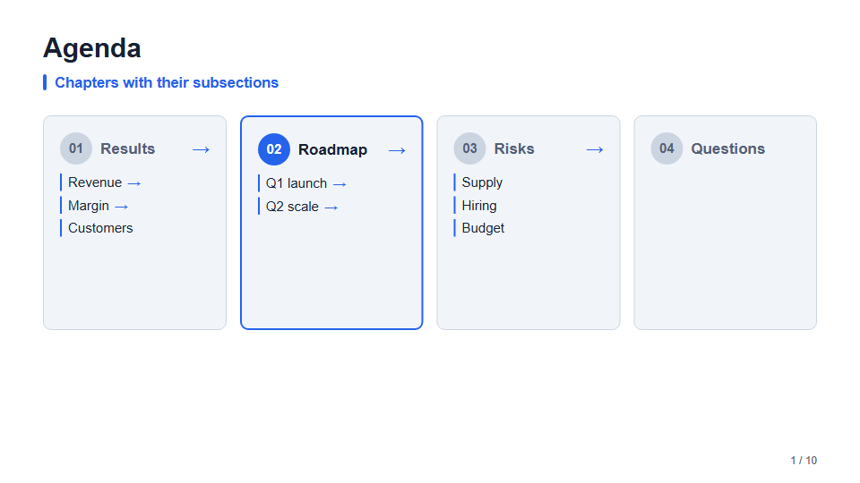 |

- **`chapters`** lists only the top level, in a large-number index. Use it for the table of contents
  at the start, or when there are many chapters.
- **`outline`** draws each chapter as a card with its subsections under it, and every subsection can
  link to a slide. Give each item `items` (1–6 subsections with `title` and an optional `slide`).
  The other variants leave the subsections out, so you can switch between them without changing the content.
- **`current`** (1-based) marks one item as the chapter being opened: the others are muted. Repeat the
  agenda at the start of each chapter with a different `current` to show the reader's progress.
- **Without `items`** the agenda lists the deck's [`section`](#section) slides, in order, each linking to its
  slide with the section's `subtitle` as the text. The links then follow the sections when you reorder
  slides. It needs two to eight sections, and has no subsections: write `items` yourself for `outline`.

### `section`

A section slide opens a chapter of a long presentation. It has only the common fields: `title` is the
chapter's name and `subtitle` is its one-line summary. The number (`01`, `02`, …) is counted over the deck's
section slides, so it does not need to be written.

| `section` (`default`) | `section/centered` | `section/band` |
| --- | --- | --- |
| 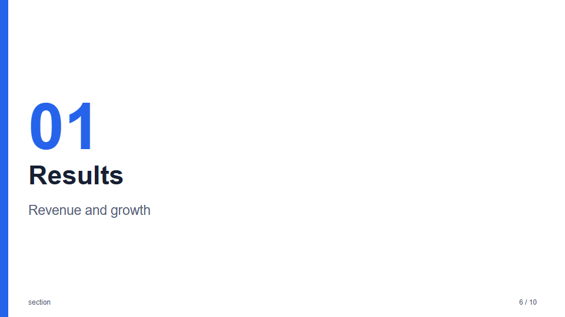 | 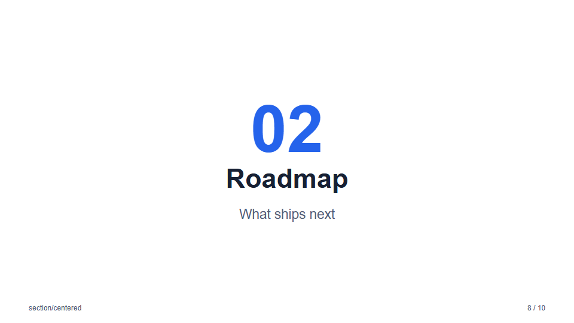 | 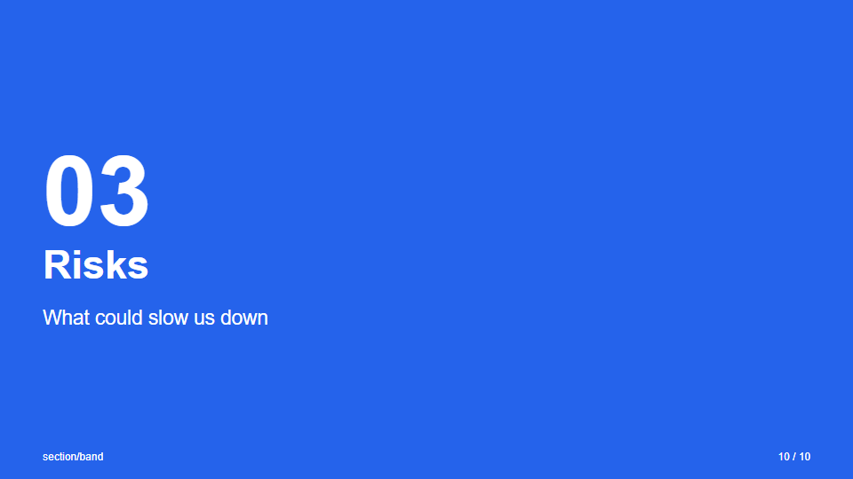 |

```json
{ "layout": "section", "title": "Results", "subtitle": "Revenue and growth" }
```

### `panels`

Panels split the slide with thin lines instead of cards: two to seven sections, each with a number, a
title, and content. Give a panel a `color` (a six-digit hex color) to fill it with that color; the text
color switches between white and near-black to stay readable.

| `panels` (`default`) | `panels/rows` |
| --- | --- |
| 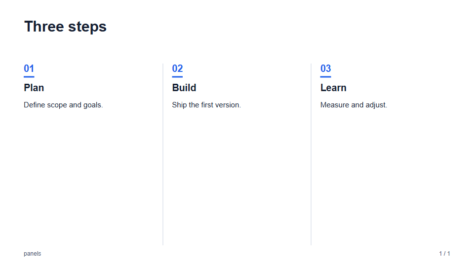 | 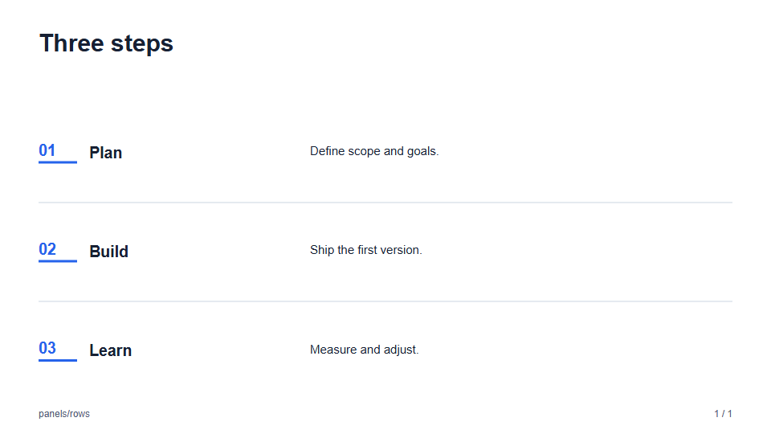 |
| 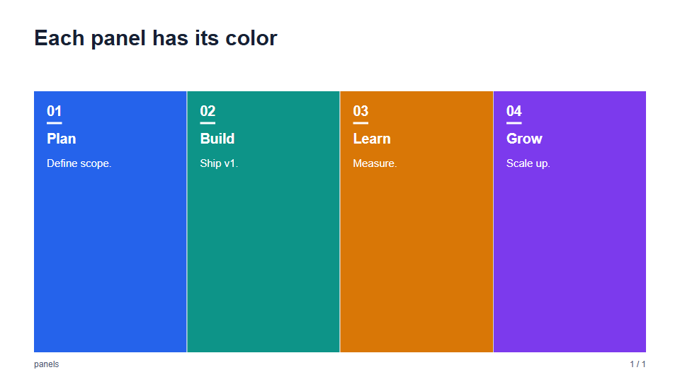 | 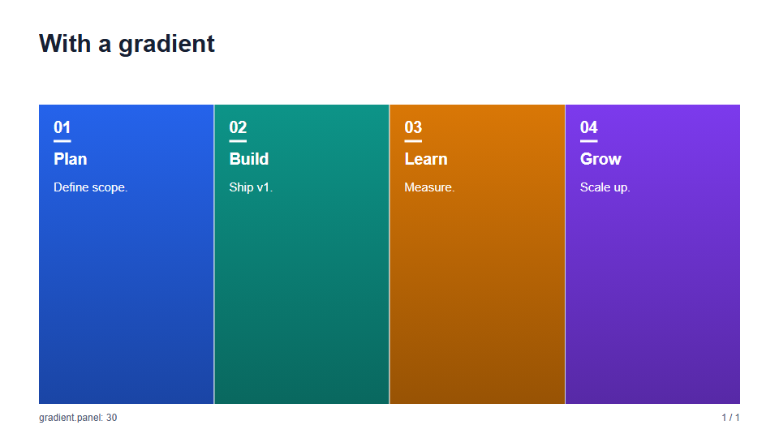 |

```json
{
  "layout": "panels",
  "title": "Three steps",
  "panels": [
    { "title": "Plan", "color": "#2563eb", "blocks": [{ "type": "paragraph", "text": "Define scope." }] },
    { "title": "Build", "blocks": [{ "type": "paragraph", "text": "Ship the first version." }] }
  ]
}
```

- **Columns and rows:** `panels` places the panels side by side, split by vertical lines. `panels/rows`
  stacks them, split by horizontal lines, with the title on the left and the content on the right. The same
  content works in both.
- **Many panels:** five or more columns are narrow, so the text is smaller. With six or seven panels, keep
  each to a short title and a line or two. Rows are shorter still.
- **Color:** a panel without `color` has no fill, only the lines. Colored panels sit flush against each other.
  The `gradient.panel` template token turns each fill into a gradient (see [templates](templates.md#gradients)).

### `timeline`

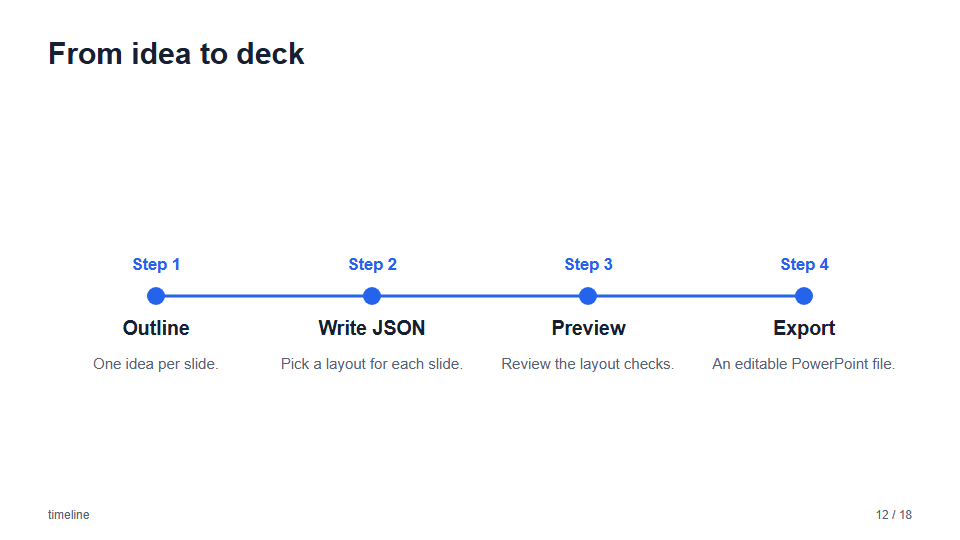

### `gantt`

A project schedule: tasks as bars over labeled periods, with optional progress.

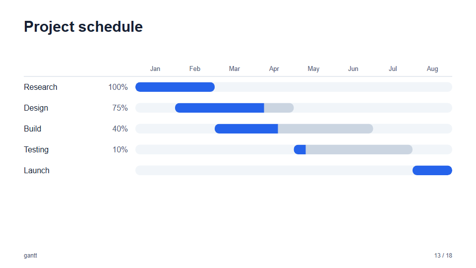

### `table` and `chart`

| `table` | `chart` |
| --- | --- |
| 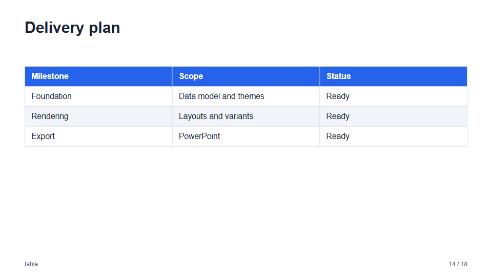 | 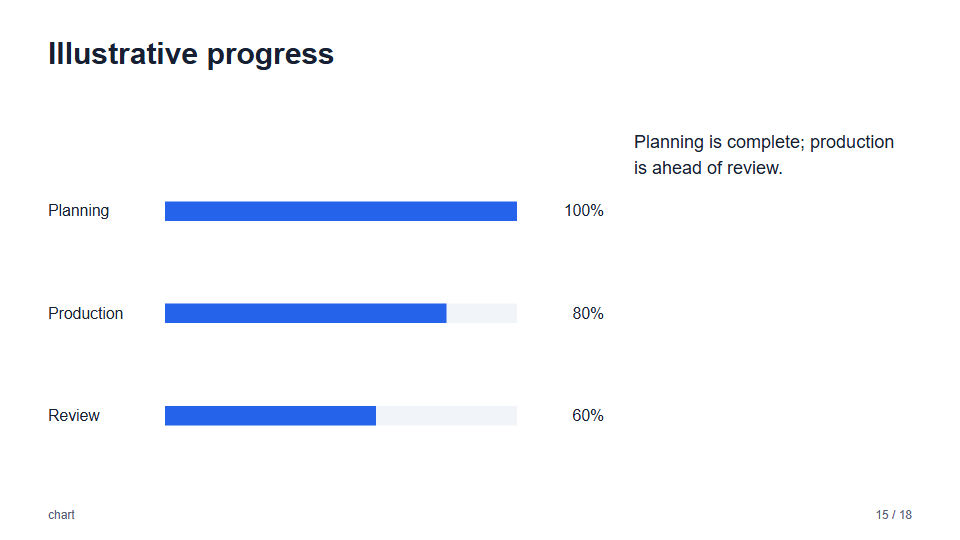 |

### `quote`

| `quote` (`default`) | `quote/centered` |
| --- | --- |
| 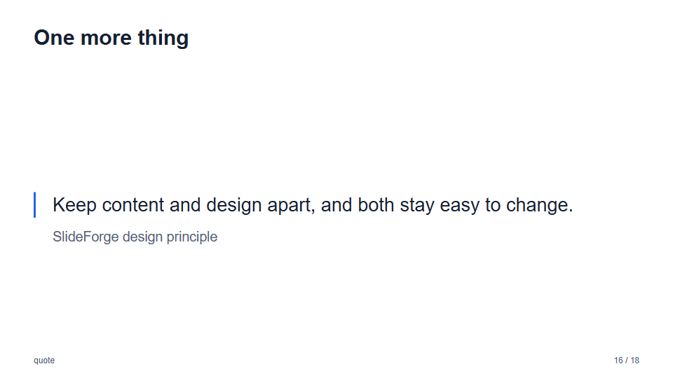 | 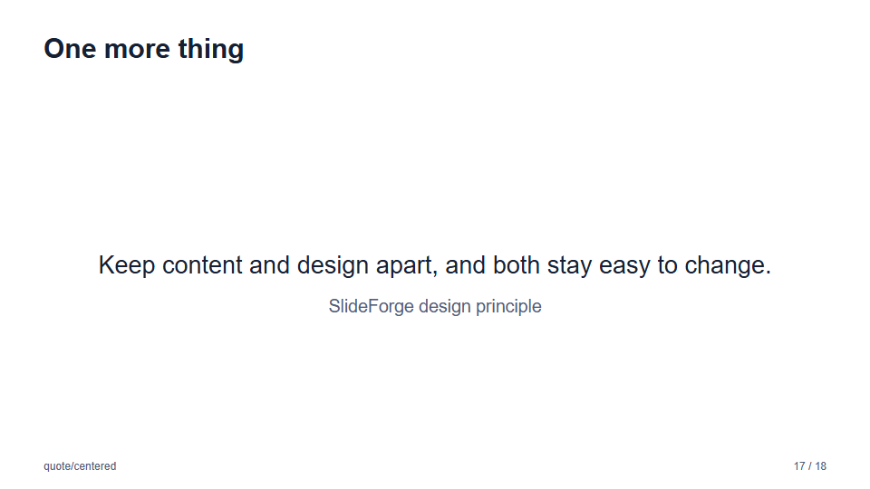 |

### `blank`

A blank slide shows only its background, here a
[Math Background Studio](backgrounds.md) design. Without a background it is an empty
slide in the theme's color.

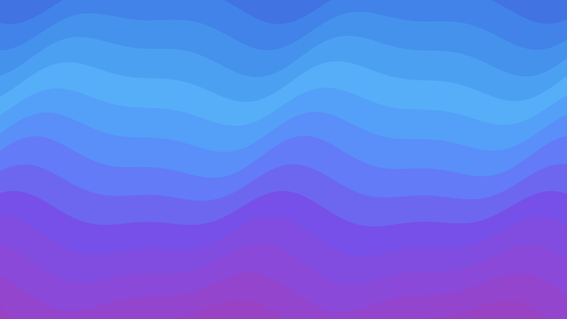

## Custom trusted HTML

For custom export input, give each slide a fixed 1920 × 1080 box and mark it with
`data-pptx="slide"` or `.slide`; alternatively pass `--selector`. Keep text and
simple fills/borders as DOM/CSS when editability matters. Upstream may rasterize
some effects or media. SlideForge does not provide automatic screenshot fallback
for arbitrary unsupported content.

Intentional decorative overlap may be marked
`data-pptx-allow-overlap="true"` on a containing element to exclude its descendants
from the overlap heuristic. This does not suppress overflow, bounds, or missing
asset checks. Prefer changing layout over suppressing diagnostics.

A full-slide background in custom HTML is a direct child of the slide marked
`data-pptx-background`, sized to the whole slide and painted behind the content,
for example `<div data-pptx-background style="position:absolute; inset:0; z-index:-1">`
containing an `` or a studio `/render` `<iframe>` (the slide needs
`isolation: isolate` or its own stacking context). Export captures that layer as
the slide's PowerPoint background, as described in
[architecture](architecture.md#slide-backgrounds). A CSS `background-image` on the
slide itself is not converted; the converter drops it.
