# Layouts: cards and panels

Slides that split content into parallel parts: cards, figures, panels, matrices, comparisons, and people. See the [layout gallery](layouts.md) for every layout.

### `cards`

The grid follows the number of cards: one card spans the width, two sit side by side,
three and six use three columns, four form a 2 × 2 grid, and five are three over two, with the lower two keeping the upper cards' width and centered.

| 2 cards | 3 cards |
| --- | --- |
| 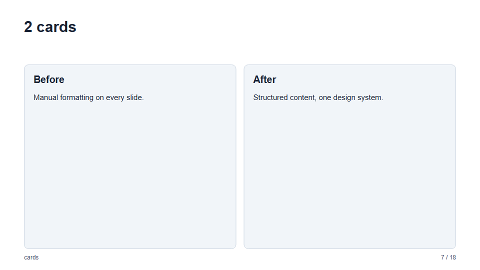 | 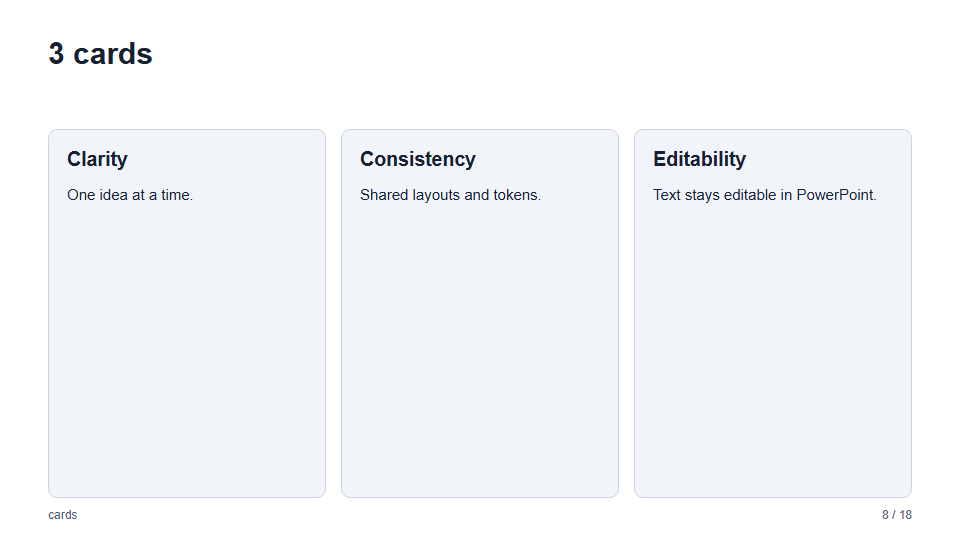 |
| **4 cards** | **5 cards** |
| 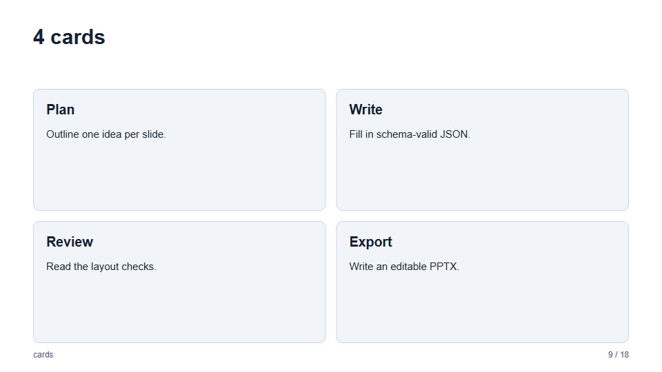 | 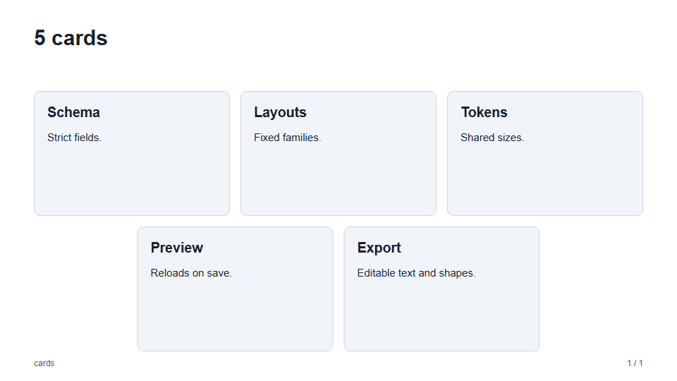 |
| **6 cards** | |
| 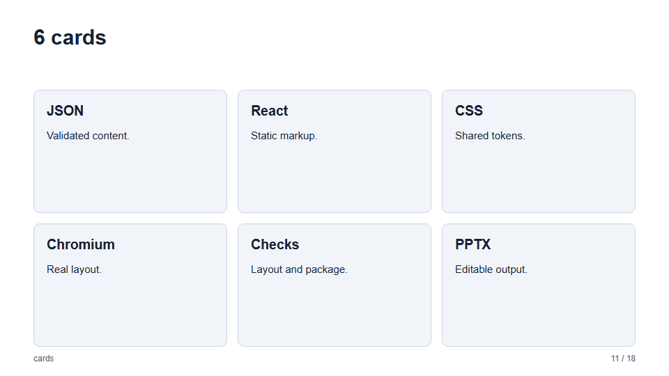 | |

Five variants change only the card shape; the fields and the grid are the same. `badge` keeps the
rectangular card and puts a numbered accent circle above its centered text. `circle`, `hexagon`, and
`pentagon` fill the whole card with an accent-colored regular shape, number the cards 1 to 6, and
center their text. These shapes keep their proportions, so they leave room above and below (or at the
sides) instead of stretching, and their text area is small: they suit a title and one or two short
lines.

| `cards/rounded` | `cards/badge` |
| --- | --- |
| 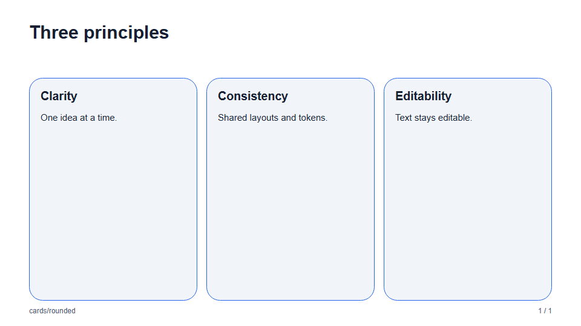 |  |
| **`cards/circle`** | |
| 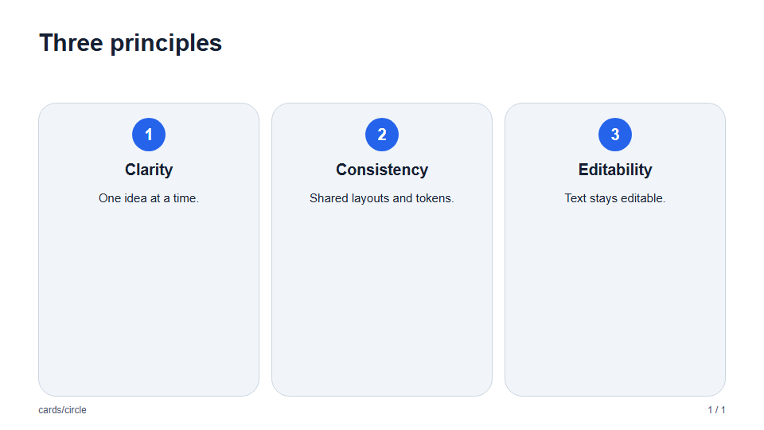 | |
| **`cards/hexagon`** | **`cards/pentagon`** |
| 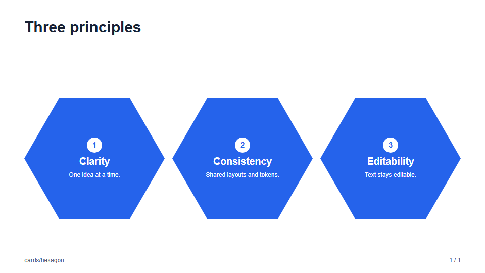 | 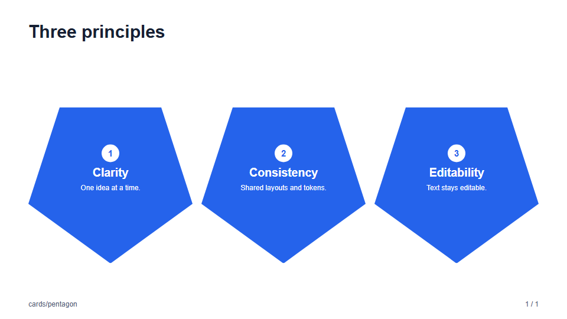 |

In PowerPoint the cards and circles are native shapes, and the polygons are native too: the hexagon and pentagon are
editable freeform shapes behind the text, and the text and number stay editable.

The slide in JSON:

```json
{
  "layout": "cards/badge",
  "title": "Three principles",
  "cards": [
    { "title": "Clarity", "blocks": [{ "type": "paragraph", "text": "One idea at a time." }] },
    { "title": "Consistency", "blocks": [{ "type": "paragraph", "text": "Shared layouts and tokens." }] },
    { "title": "Editability", "blocks": [{ "type": "paragraph", "text": "Text stays editable." }] }
  ]
}
```

### `stats`

Key figures: two to six large numbers, each with a label and an optional line of text. Keep each `value` short
(`98%`, `$4.2M`, `3.1x`); it is drawn in the accent color at a large size.

| `stats` (`default`) | `stats/cards` |
| --- | --- |
| 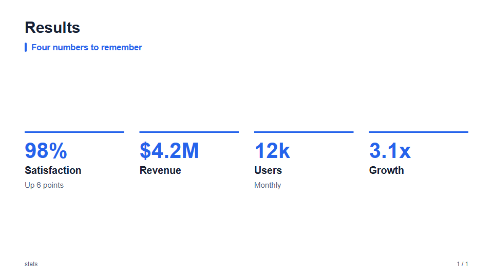 | 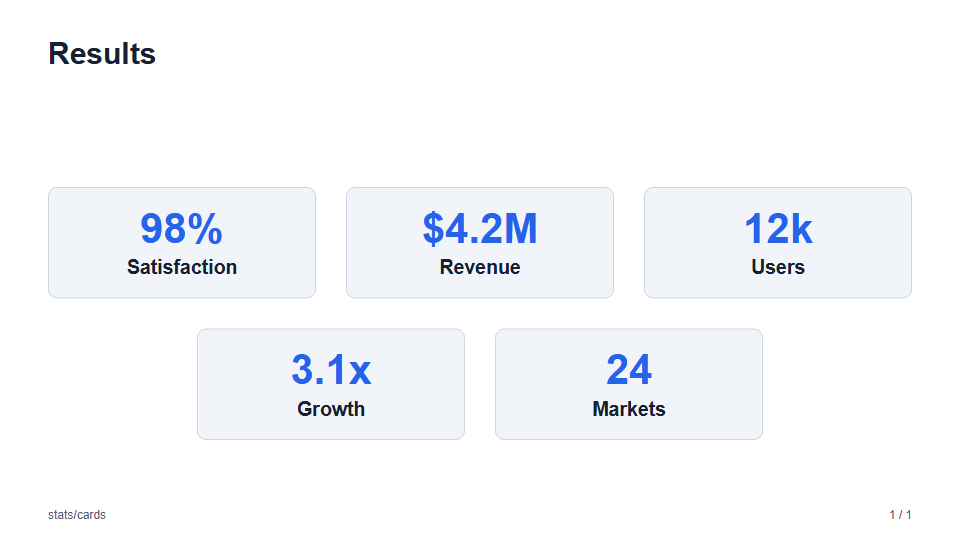 |

```json
{
  "layout": "stats",
  "title": "Results",
  "stats": [
    { "value": "98%", "label": "Satisfaction", "text": "Up 6 points" },
    { "value": "$4.2M", "label": "Revenue" }
  ]
}
```

- **Arrangement:** up to four figures sit in one row, five and six use three columns, and the lower two of five stay
  centered, as for [cards](#cards). Figures shrink from four up.
- **Variants:** `default` puts a rule above each figure, and `cards` centers each on a card.
- **Detail:** optional `labelDetail` adds a separate second label line at card-body size
  (default 30px versus the label's 39px). Both lines accept [display text](schema.md#display-text-and-font-sizes).
- **Highlight:** `highlight: true` fills that figure with the accent color and uses on-accent text,
  in both variants and themes. Omitted/false preserves its usual styling.

```json
{
  "value": "96–128",
  "label": { "text": "New or changed", "fontSize": { "delta": -3 } },
  "labelDetail": { "text": "Estimated files", "fontSize": { "delta": -4 } },
  "highlight": true
}
```

### `panels`

Panels split the slide with thin lines instead of cards: two to seven sections, each with an optional
number, a title, and content. Give a panel a `color` (a six-digit hex color) to fill it with that color; the text
color switches between white and near-black to stay readable.

| `panels` (`default`) | `panels/rows` |
| --- | --- |
| 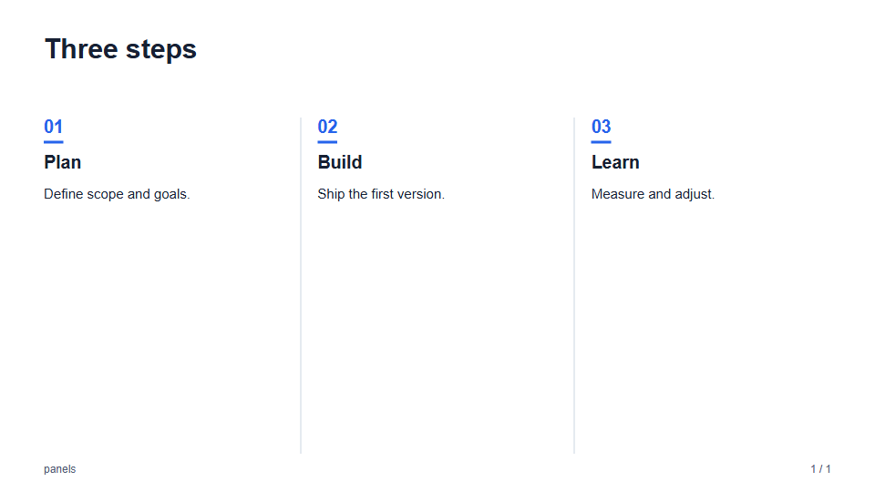 | 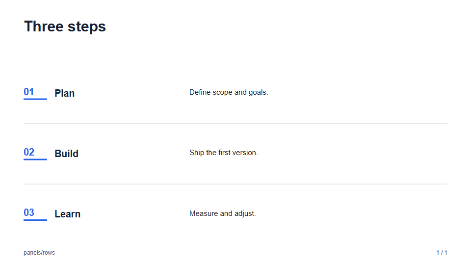 |
| 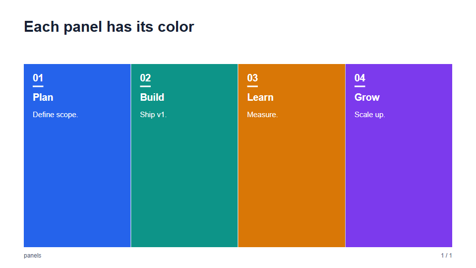 | 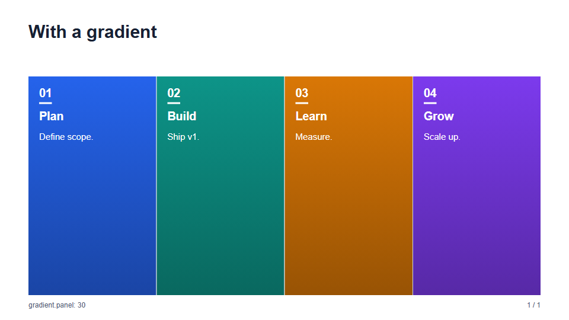 |

```json
{
  "layout": "panels",
  "title": "Three steps",
  "panels": [
    { "title": "Plan", "color": "#2563eb", "blocks": [{ "type": "paragraph", "text": "Define scope." }] },
    { "title": "Build", "blocks": [{ "type": "paragraph", "text": "Ship the first version." }] }
  ]
}
```

- **Columns and rows:** `panels` places the panels side by side, split by vertical lines. `panels/rows`
  stacks them, split by horizontal lines, with the title on the left and the content on the right. The same
  content works in both.
- **Numbering:** use slide-level `"numbered": false` for parallel topics or document summaries.
  Panels start directly with their titles; rows reclaim the number column for content.
  Omit `numbered` or set it to `true` to keep the existing numbered layout for ordered steps.
- **Many panels:** five or more columns are narrow, so the text is smaller. With six or seven panels, keep
  each to a short title and a line or two. Rows are shorter still.
- **Color:** a panel without `color` has no fill, only the lines. Colored panels sit flush against each other.
  The `gradient.panel` template token turns each fill into a gradient (see [templates](templates.md#gradients)).

### `matrix`

A 2 × 2 matrix, such as priorities, risk and impact, or a SWOT: exactly four quadrants (top left, top right, bottom
left, bottom right), each with a title and blocks. `xAxis` and `yAxis` are optional names: the vertical one is drawn above
the grid with an up arrow, and the horizontal one below it with a right arrow.

| `matrix` (`default`) | `matrix/lines` |
| --- | --- |
| 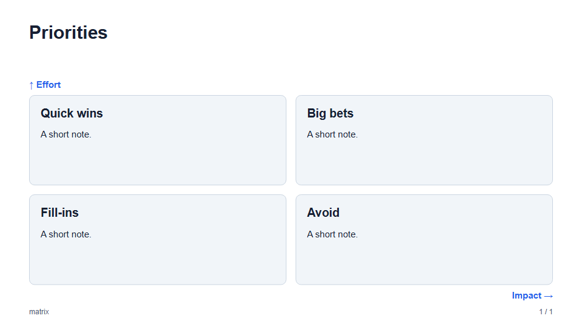 | 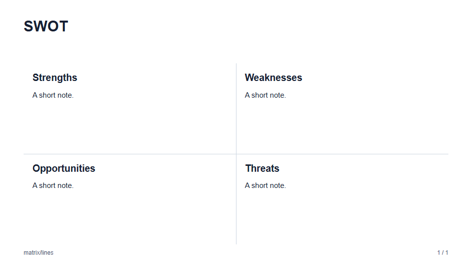 |

- **Variants:** `default` draws four cards, and `lines` leaves the quadrants open and splits them with a cross of two
  lines.
- **Export:** the cards or lines and the text are separate editable shapes.

The slide in JSON:

```json
{
  "layout": "matrix/lines",
  "title": "Where to start",
  "xAxis": "Impact",
  "yAxis": "Effort",
  "quadrants": [
    { "title": "Quick wins", "blocks": [{ "type": "paragraph", "text": "Small effort, clear gain." }] },
    { "title": "Big bets", "blocks": [{ "type": "paragraph", "text": "Large effort, large gain." }] },
    { "title": "Fill-ins", "blocks": [{ "type": "paragraph", "text": "Do when there is time." }] },
    { "title": "Avoid", "blocks": [{ "type": "paragraph", "text": "Large effort, small gain." }] }
  ]
}
```

### `compare`

Two to four options side by side, such as plans or alternatives. Each has a `title`, an optional `label` (a price or
tag), and one to eight `items`, drawn with a check mark. Set `highlight` on one option to draw it with an accent header
and outline, to mark the recommended choice.

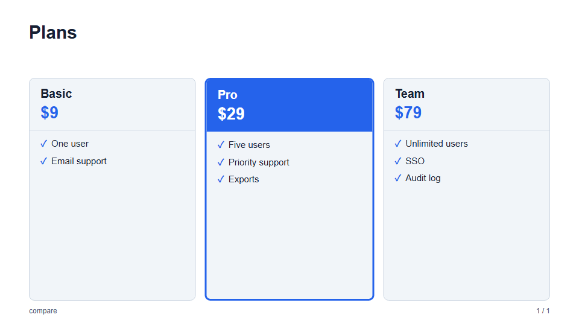

```json
{
  "layout": "compare",
  "title": "Plans",
  "options": [
    { "title": "Basic", "label": "$9", "items": ["One user"] },
    { "title": "Pro", "label": "$29", "highlight": true, "items": ["Five users", "Priority support"] }
  ]
}
```

### `team`

People in cards: two to six members, each with a `name`, an optional `role` and `text`, and an optional `image`. A
portrait is drawn as a circle; without one, the first letter of the name is drawn in an accent circle.

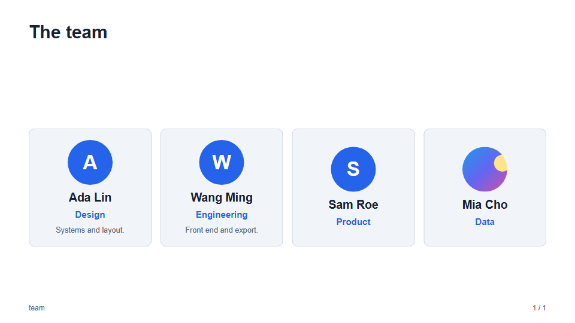

- **Arrangement:** like [cards](#cards): up to three in a row, four in one row, and the lower two of five centered.
- **Export:** a portrait is a picture, and an initial is an editable circle with text.

The slide in JSON:

```json
{
  "layout": "team",
  "title": "The team",
  "members": [
    { "name": "Ada Lin", "role": "Design", "text": "Systems and layout.", "image": "assets/ada.png" },
    { "name": "Sam Roe", "role": "Engineering" },
    { "name": "Mia Cho", "role": "Product" }
  ]
}
```
