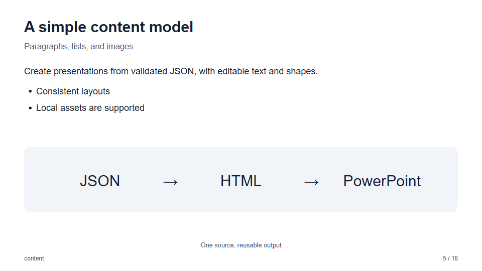
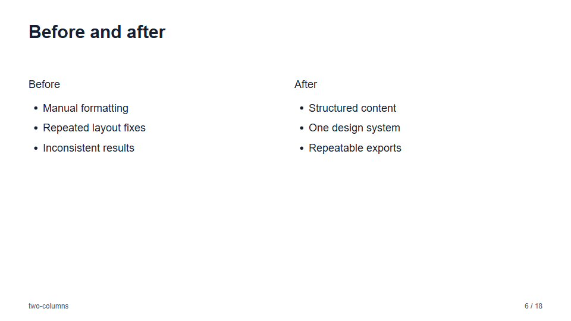
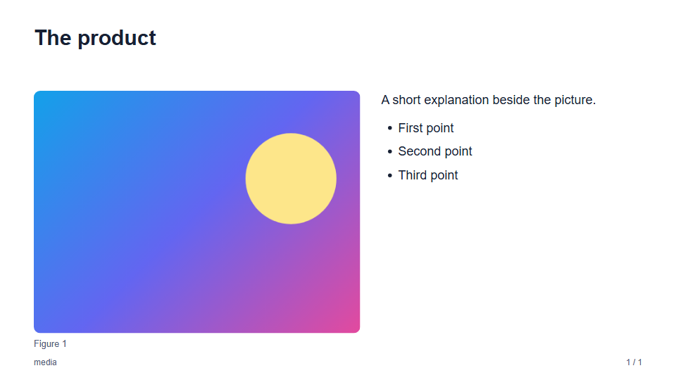
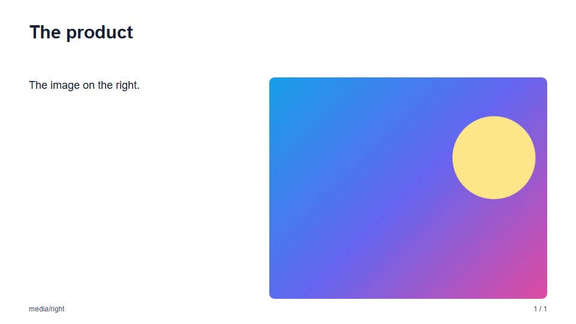
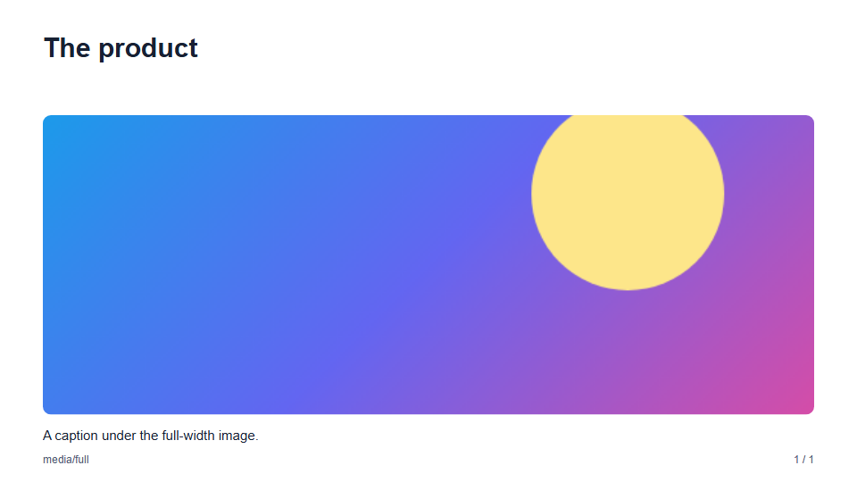
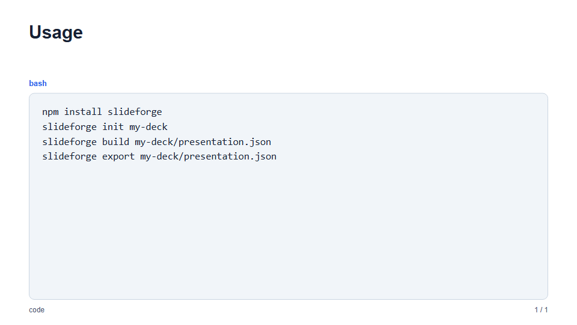
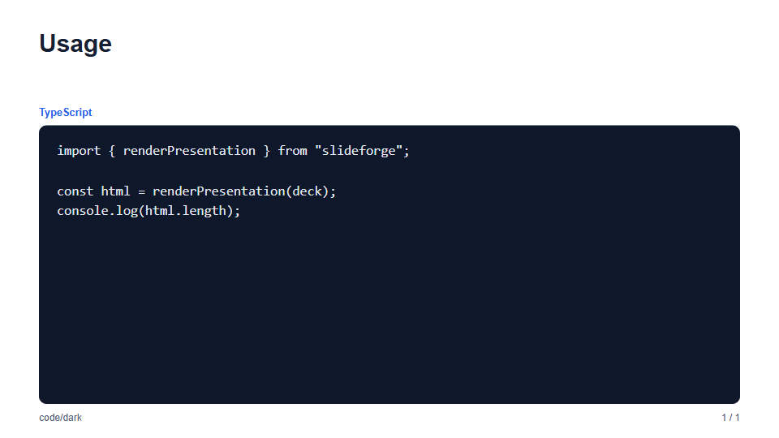

# Layouts: text and media

Slides built from paragraphs, lists, images, quotes, and code. See the [layout gallery](layouts.md) for every layout.

### `content` and `two-columns`

| `content` | `two-columns` |
| --- | --- |
|  |  |

The slide in JSON:

`content`:

```json
{
  "layout": "content",
  "title": "This week",
  "subtitle": "Text, lists, and images",
  "blocks": [
    { "type": "paragraph", "text": "The first milestone is complete." },
    { "type": "bullets", "items": ["Review", "Refine", "Export"] },
    { "type": "image", "src": "assets/diagram.svg", "alt": "The export flow", "caption": "One source" }
  ]
}
```

`two-columns`:

```json
{
  "layout": "two-columns",
  "title": "Before and after",
  "left": [{ "type": "bullets", "items": ["Manual formatting", "Inconsistent results"] }],
  "right": [{ "type": "bullets", "items": ["Structured content", "Repeatable exports"] }]
}
```

### `media`

A picture as the subject. `image` is an image source (relative path, HTTP(S) URL, or base64 raster image) with required
`alt` text, an optional `caption`, and optional `blocks` of text.

| `media` (`default`) | `media/right` | `media/full` |
| --- | --- | --- |
|  |  |  |

- **Variants:** `default` puts the picture on the left, `right` on the right, and `full` across the slide with the text
  below it. Without `blocks` the picture fills the whole content area.
- **Cropping:** the picture fills its area, cropped to fit, so choose an image with room around its subject. The
  export keeps the crop as a picture.

The slide in JSON:

```json
{
  "layout": "media",
  "title": "The product",
  "image": "assets/product.png",
  "alt": "The product on a desk",
  "caption": "Figure 1",
  "blocks": [{ "type": "paragraph", "text": "A short explanation." }]
}
```

### `code`

A code listing in a monospaced font, kept as written, with an optional `language` label above it. The listing may
have up to 18 lines (and 3,000 characters), so it fits the slide.

| `code` (`default`) | `code/dark` |
| --- | --- |
|  |  |

- **Font:** Consolas, falling back to Cascadia Mono and Courier New. Install a monospaced font on the target machine
  for PowerPoint to use it.
- **No highlighting:** the code is plain text; SlideForge does not color syntax.

The slide in JSON:

```json
{
  "layout": "code",
  "title": "Usage",
  "language": "bash",
  "code": "npm install slideforge\nslideforge init my-deck"
}
```
