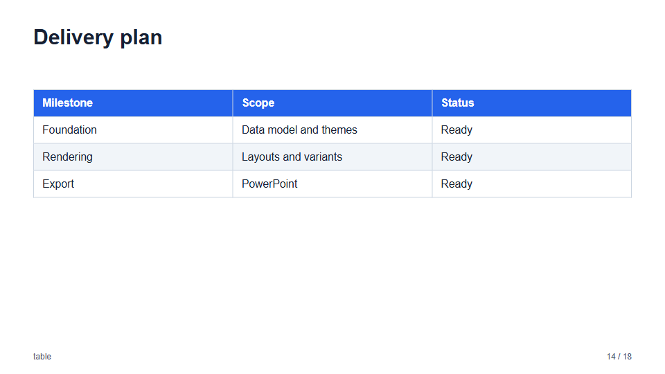
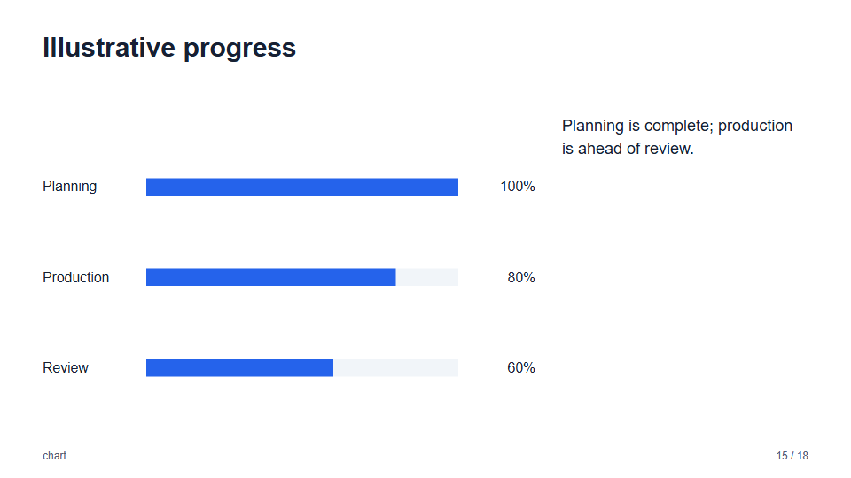
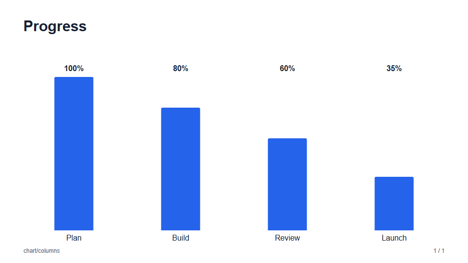
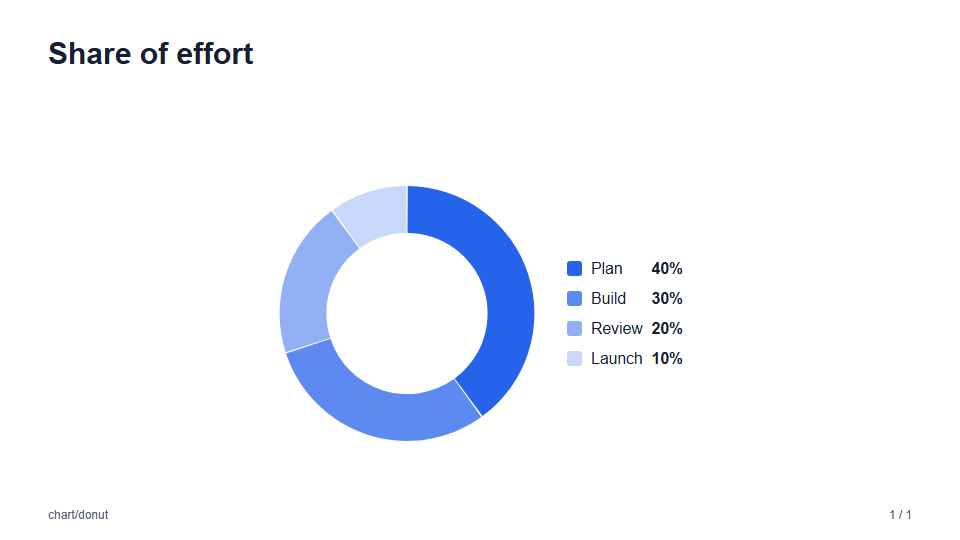
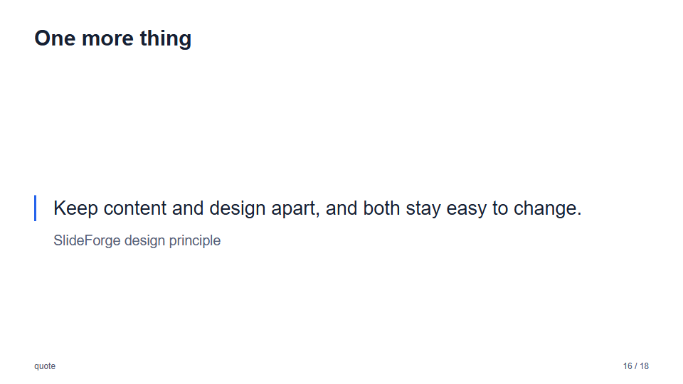
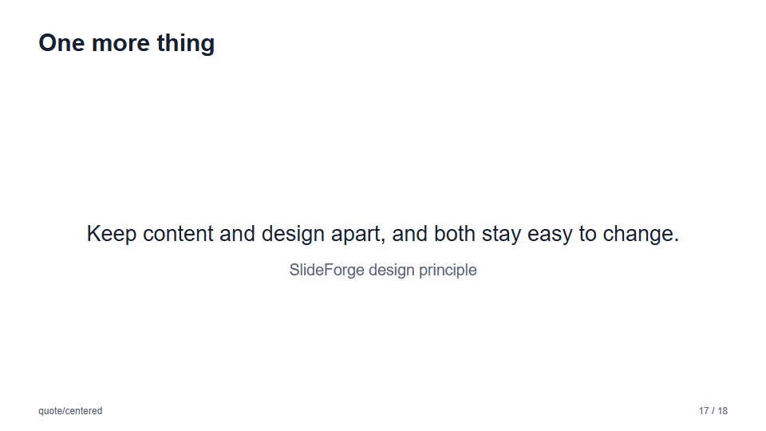

# Layouts: tables, charts, and quotes

Slides that present data, and a quotation. See the [layout gallery](layouts.md) for every layout.

### `table` and `chart`

| `table` | `chart` |
| --- | --- |
|  |  |

The chart has three variants over the same `data`:

| `chart` (`default`) | `chart/columns` | `chart/donut` |
| --- | --- | --- |
|  |  |  |

- **`columns`** draws vertical columns with the value above and the label below.
- **`donut`** draws a ring of shares with a legend of each label and its percentage of the total. The ring is exported as
  editable freeform shapes; the legend text stays editable.

The slide in JSON:

`table`:

```json
{
  "layout": "table",
  "title": "Delivery plan",
  "columns": ["Milestone", "Scope", "Status"],
  "rows": [
    ["Foundation", "Data model and themes", "Ready"],
    ["Export", "PowerPoint", "Ready"]
  ]
}
```

`chart`:

```json
{
  "layout": "chart/donut",
  "title": "Share of effort",
  "unit": "%",
  "data": [
    { "label": "Plan", "value": 40 },
    { "label": "Build", "value": 35 },
    { "label": "Review", "value": 25 }
  ],
  "blocks": [{ "type": "paragraph", "text": "Optional text beside the chart." }]
}
```

### `quote`

| `quote` (`default`) | `quote/centered` |
| --- | --- |
|  |  |

The slide in JSON:

```json
{
  "layout": "quote/centered",
  "title": "One more thing",
  "quote": "Keep content and design apart, and both stay easy to change.",
  "attribution": "SlideForge design principle"
}
```
