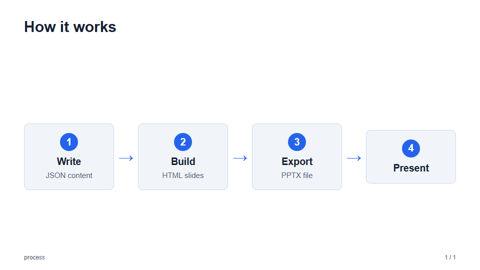
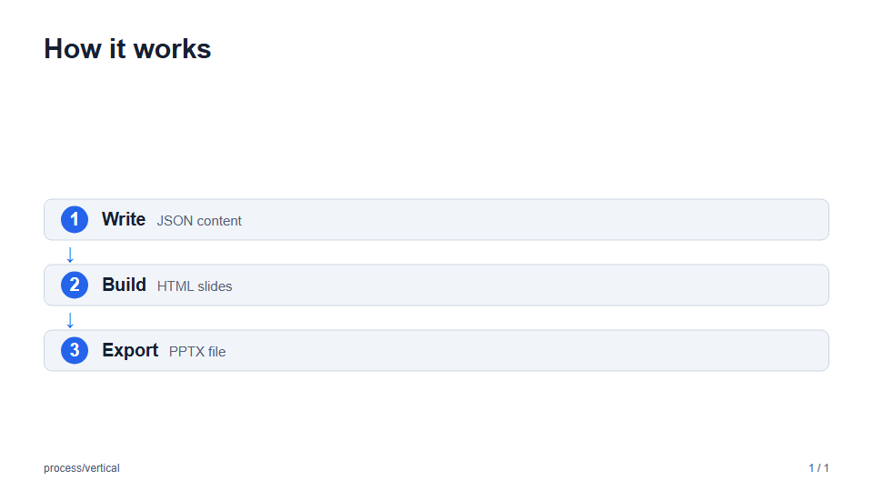
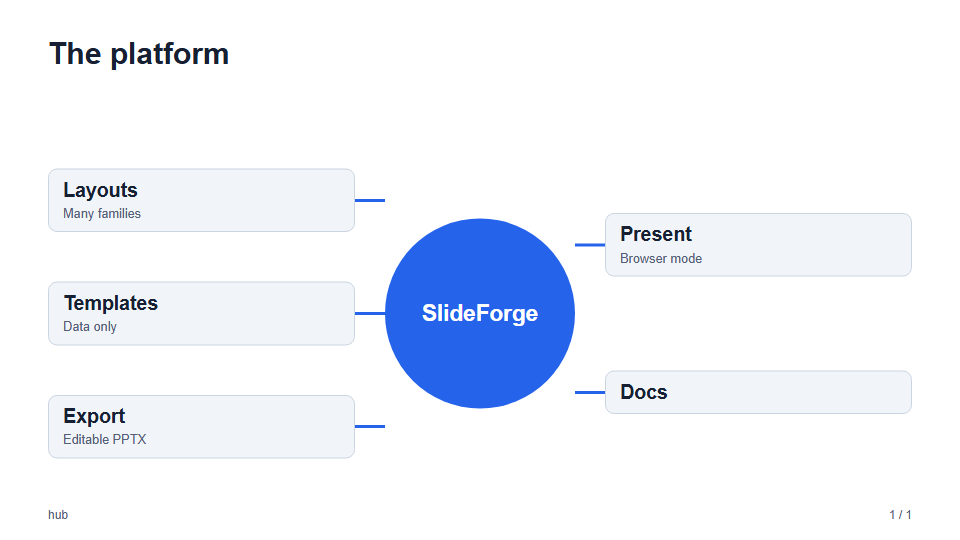
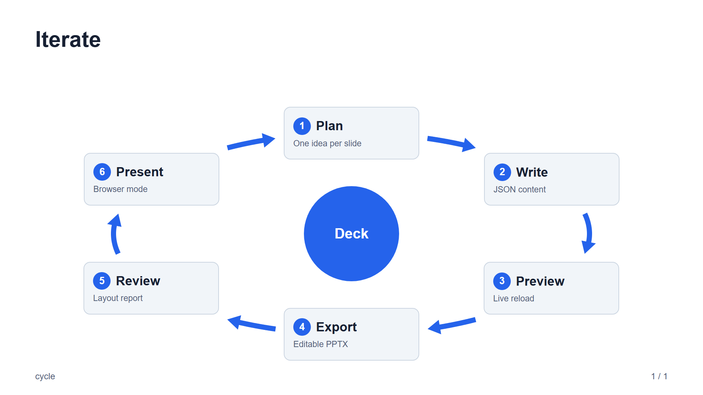
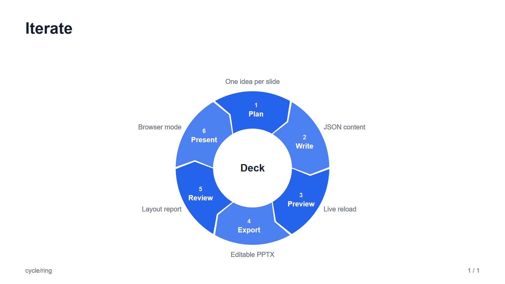
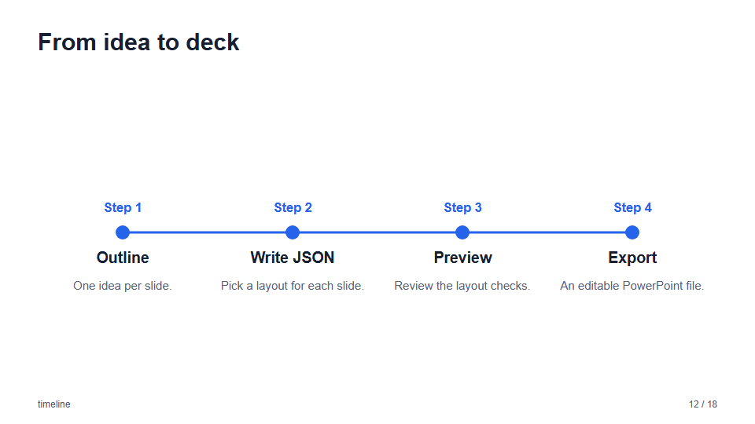
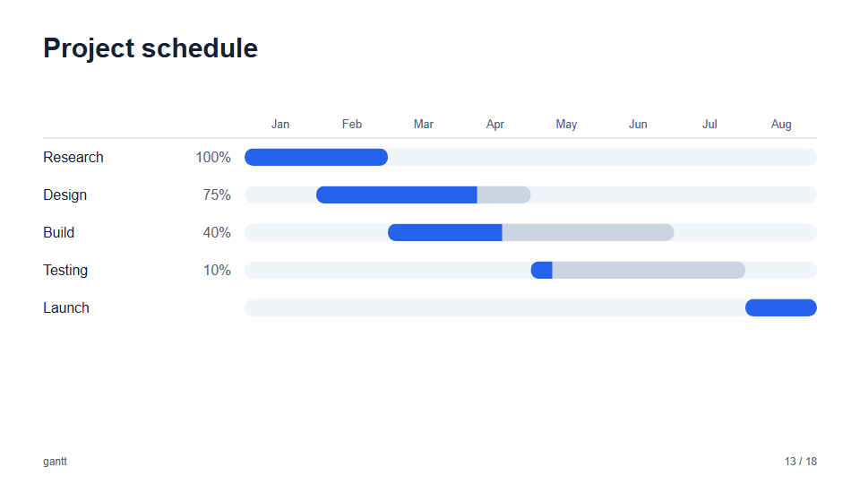

# Layouts: flows and diagrams

Slides that show order, dependence, a central idea, or a repeating cycle. See the [layout gallery](layouts.md) for every layout.

### `process`

Numbered steps in order, joined by arrows: two to six steps, each with a `title` and an optional `text`. Use it for a flow or
a procedure; use [timeline](#timeline) when the steps have dates.

| `process` (`default`) | `process/vertical` |
| --- | --- |
|  |  |

- **Variants:** `default` places the steps in a row, and `vertical` stacks them with the title and text on one line. Five or six
  steps in a row are narrow, so keep their text short.

The slide in JSON:

```json
{
  "layout": "process",
  "title": "How it works",
  "steps": [
    { "title": "Write", "text": "JSON content" },
    { "title": "Build", "text": "HTML slides" },
    { "title": "Export" }
  ]
}
```

### `hub`

A central idea with three to six items around it. The `center` is an accent circle; the `items` are cards, the first half
on the left and the rest on the right, each joined to the center by a line.



```json
{
  "layout": "hub",
  "title": "The platform",
  "center": "SlideForge",
  "items": [{ "title": "Layouts" }, { "title": "Templates" }, { "title": "Export" }]
}
```

### `cycle`

Three to eight steps around a ring that repeats, such as a development life cycle. The `steps` are cards placed clockwise
from the top, each joined to the next by a curved arrow, and the last one leads back to the first. An optional `center` is an
accent circle in the middle of the ring.

- The steps are spaced evenly along the ring, measured in card sizes, so cards do not crowd at its narrow ends. More steps
  get smaller cards: seven or eight steps leave room for a short title and one or two short lines of text.
- The arrows are one inline SVG drawn under the cards; each stops short of the next card. Export writes them as one SVG
  picture, while the cards, numbers, center circle, and text stay editable shapes and text.
- **Variants:** `ring` draws the steps as segments of one ring instead of cards: each segment ends in a triangular tip
  that nests into a notch at the start of the next one. The number and `title` sit on the segment, so keep titles to
  about five CJK characters or one or two short words; the `text` goes outside the ring, beside it on the left and right
  and on one line above or below it at the top and bottom. The ring is one SVG picture in PowerPoint; the text stays editable.

| `cycle` (`default`) | `cycle/ring` |
| --- | --- |
|  |  |

```json
{
  "layout": "cycle",
  "title": "Iterate",
  "center": "Deck",
  "steps": [
    { "title": "Write", "text": "JSON content" },
    { "title": "Preview", "text": "Live reload" },
    { "title": "Export", "text": "Editable PPTX" },
    { "title": "Review" }
  ]
}
```

### `timeline`



The slide in JSON:

```json
{
  "layout": "timeline",
  "title": "From idea to deck",
  "events": [
    {
      "date": "Step 1",
      "title": "Outline",
      "text": "One idea per slide."
    },
    { "date": "Step 2", "title": "Write JSON" },
    { "date": "Step 3", "title": "Export" }
  ]
}
```

### `gantt`

A project schedule: tasks as bars over labeled periods, with optional progress.



The slide in JSON:

```json
{
  "layout": "gantt",
  "title": "Project schedule",
  "barRadius": 12,
  "periods": ["Jan", "Feb", "Mar", "Apr", "May", "Jun"],
  "tasks": [
    { "label": "Research", "start": 1, "end": 2 },
    { "label": "Design", "start": 2, "end": 4, "progress": 60 },
    { "label": "Launch", "start": 6, "end": 6 }
  ]
}
```

Optional `barRadius` sets this slide's bar and track corner radius in CSS pixels
(finite 0–120, decimals accepted). Omit it to keep the template's shared
`tokens.border.radius`; `0` explicitly restores square corners. It does not
change the template or other layouts. Progress fill is clipped inside the bar,
so 0%, partial, and 100% progress keep their existing behavior.
