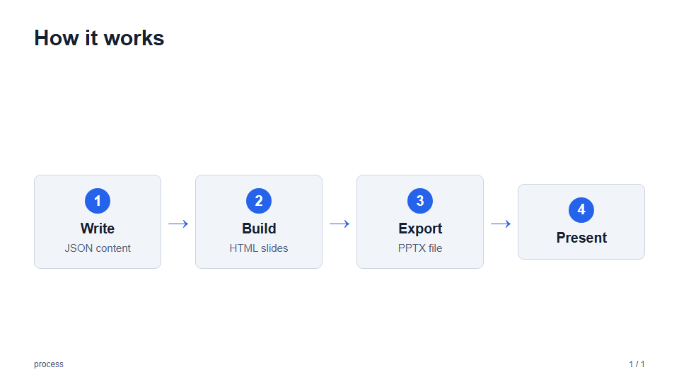
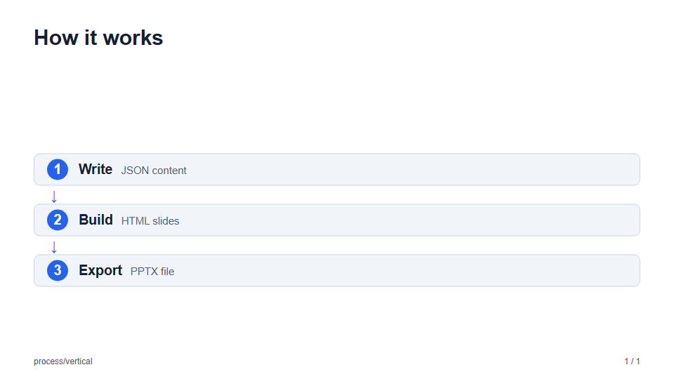
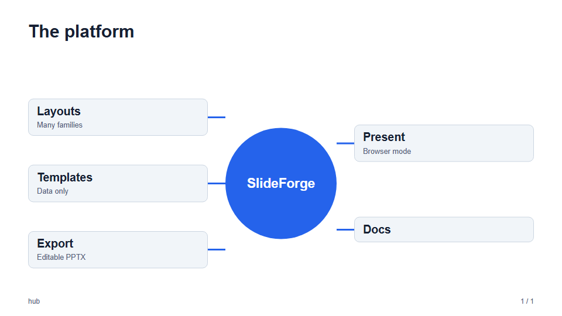
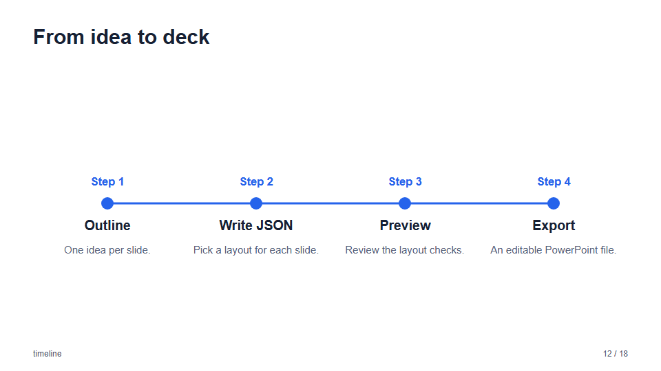
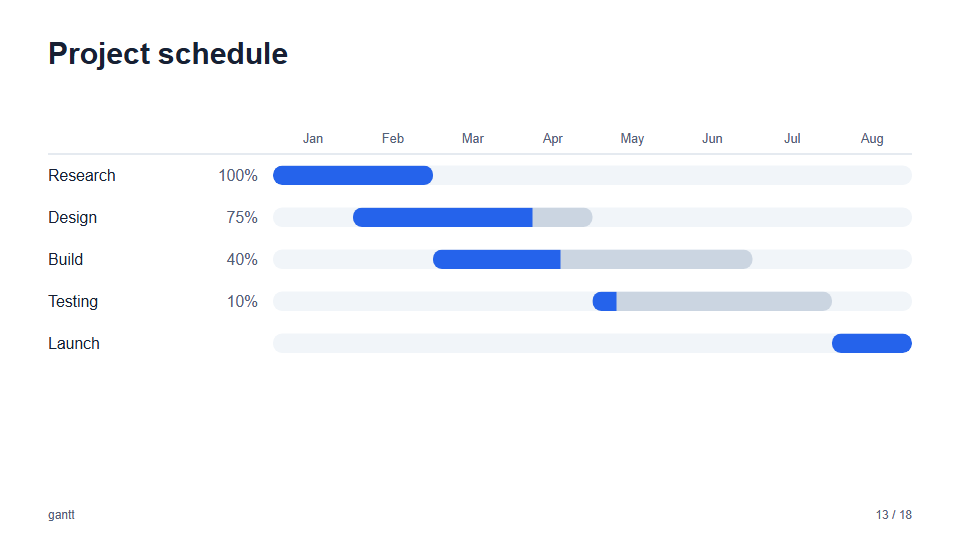

# Layouts: flows and diagrams

Slides that show order, dependence, or a central idea. See the [layout gallery](layouts.md) for every layout.

### `process`

Numbered steps in order, joined by arrows: two to six steps, each with a `title` and an optional `text`. Use it for a flow or
a procedure; use [timeline](#timeline) when the steps have dates.

| `process` (`default`) | `process/vertical` |
| --- | --- |
|  |  |

- **Variants:** `default` places the steps in a row, and `vertical` stacks them with the title and text on one line. Five or six
  steps in a row are narrow, so keep their text short.

### `hub`

A central idea with three to six items around it. The `center` is an accent circle; the `items` are cards, the first half
on the left and the rest on the right, each joined to the center by a line.



```json
{
  "layout": "hub",
  "title": "The platform",
  "center": "SlideForge",
  "items": [{ "title": "Layouts" }, { "title": "Templates" }, { "title": "Export" }]
}
```

### `timeline`



### `gantt`

A project schedule: tasks as bars over labeled periods, with optional progress.


