# Layouts: opening, structure, and ending

Slides that open a presentation, divide it, link its parts, and close it. See the [layout gallery](layouts.md) for every layout.

### `cover`

| `cover` (`default`) | `cover/centered` |
| --- | --- |
| 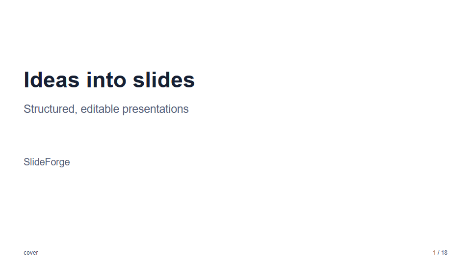 | 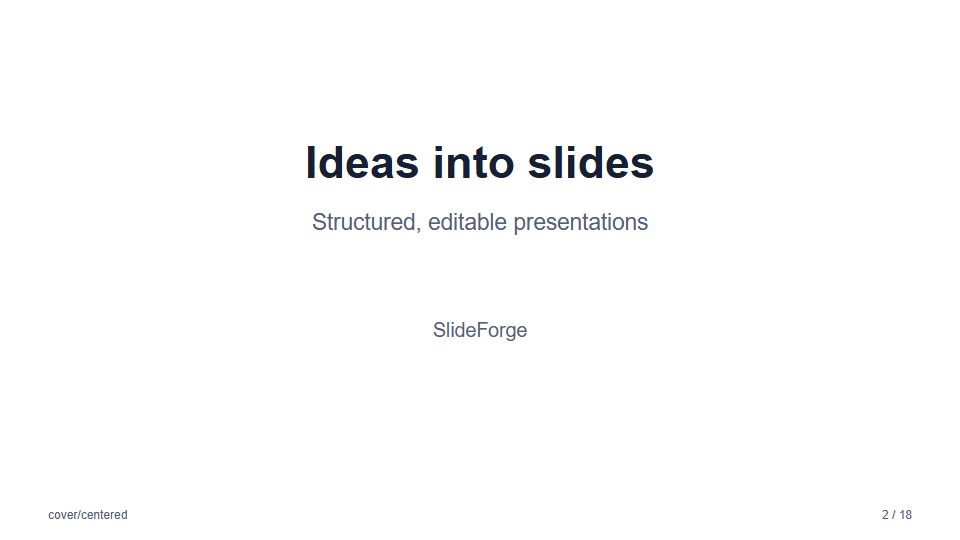 |
| **`cover/split`** | **`cover/band`** |
| 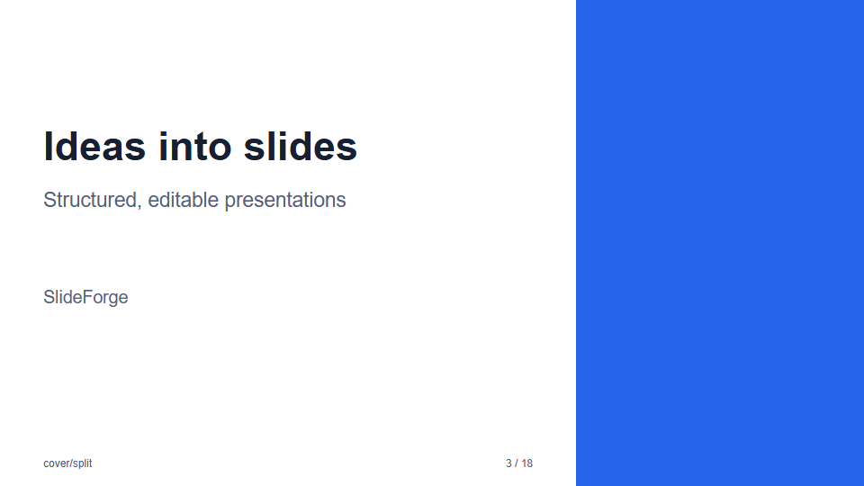 | 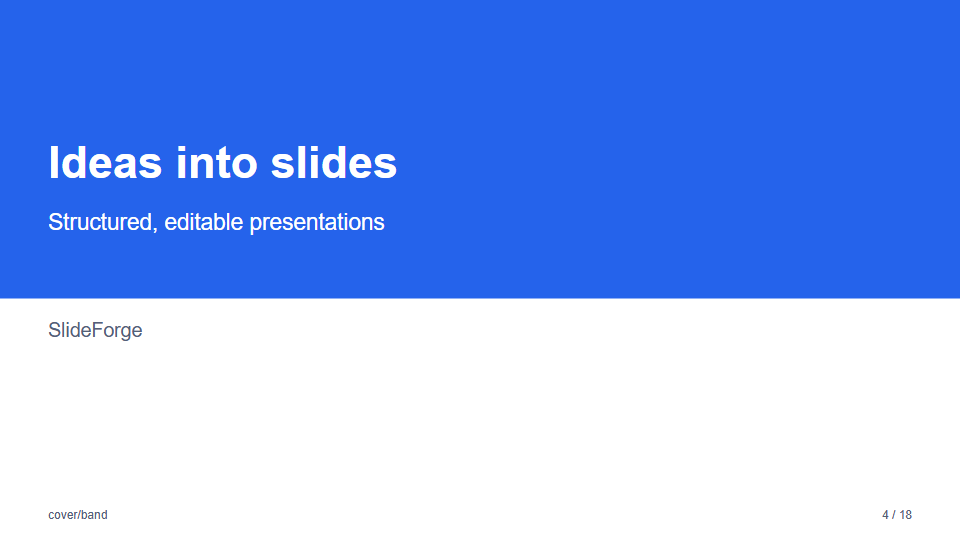 |

### `agenda`

An agenda lists two to eight topics as numbered rows: a number circle, a title, and optional text. Give an
item `slide` (the 1-based number of another slide) to make the row a link. A linked row ends with an
arrow and jumps to that slide.

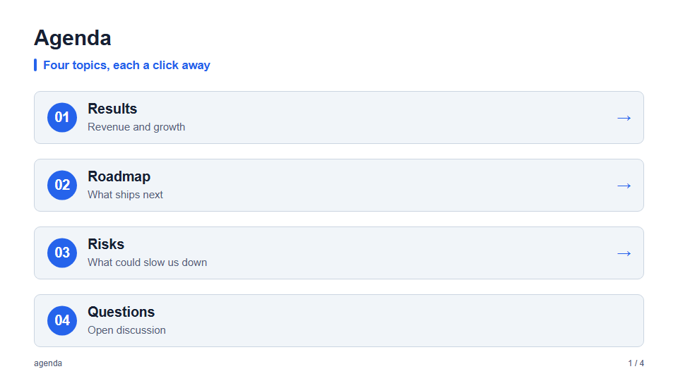

```json
{
  "layout": "agenda",
  "title": "Agenda",
  "subtitle": "Four topics, each a click away",
  "items": [
    { "title": "Results", "text": "Revenue and growth", "slide": 2 },
    { "title": "Questions" }
  ]
}
```

- **In HTML:** the row is an anchor to the slide (`#slide-2`). In `present` mode (and a build made with
  `--present`) a click jumps to it; a plain built file has no scripts, so it relies on the browser's
  anchor, which an asset base URL would resolve against that base.
- **In PowerPoint:** each linked row (its box, number, text, and arrow) is a "go to slide" button
  (`ppaction://hlinksldjump`), so clicking it in slide show, or Ctrl+click in editing, jumps to the
  target. The text keeps its design: it is not recolored or underlined like a text hyperlink.
- **Checks:** a `slide` that is less than 1 or larger than the number of slides is rejected. The
  link follows the slide's position, so renumber `slide` when you insert or reorder slides.
- **Layout:** up to four items are rows; five to eight are two columns. Keep titles short, and use
  `text` for a few words.

An agenda for a long deck has three variants, and the same `items` work in each of them:

| `agenda/chapters` | `agenda/outline` |
| --- | --- |
| 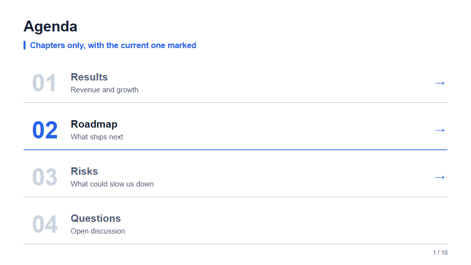 | 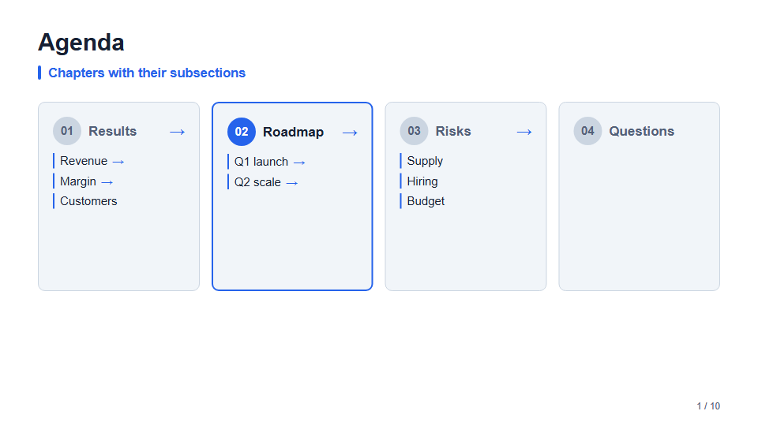 |

- **`chapters`** lists only the top level, in a large-number index. Use it for the table of contents
  at the start, or when there are many chapters.
- **`outline`** draws each chapter as a card with its subsections under it, and every subsection can
  link to a slide. Give each item `items` (1–6 subsections with `title` and an optional `slide`).
  The other variants leave the subsections out, so you can switch between them without changing the content.
- **`current`** (1-based) marks one item as the chapter being opened: the others are muted. Repeat the
  agenda at the start of each chapter with a different `current` to show the reader's progress.
- **Without `items`** the agenda lists the deck's [`section`](layouts-structure.md#section) slides, in order, each linking to its
  slide with the section's `subtitle` as the text. The links then follow the sections when you reorder
  slides. It needs two to eight sections, and has no subsections: write `items` yourself for `outline`.

### `section`

A section slide opens a chapter of a long presentation. It has only the common fields: `title` is the
chapter's name and `subtitle` is its one-line summary. The number (`01`, `02`, …) is counted over the deck's
section slides, so it does not need to be written.

| `section` (`default`) | `section/centered` | `section/band` |
| --- | --- | --- |
| 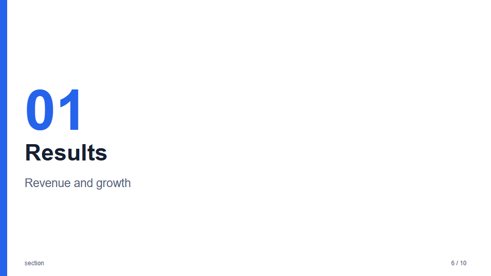 | 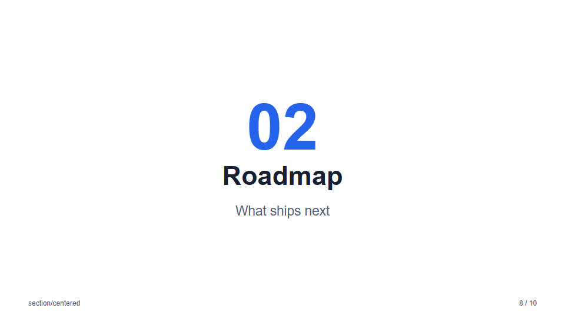 | 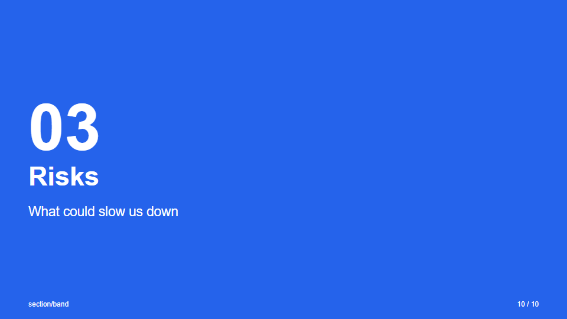 |

```json
{ "layout": "section", "title": "Results", "subtitle": "Revenue and growth" }
```

### `closing`

The last slide: the `title` and `subtitle` as the farewell, and up to four `contacts`, each a `label` and a `value`.

| `closing` (`default`) | `closing/centered` | `closing/band` |
| --- | --- | --- |
| 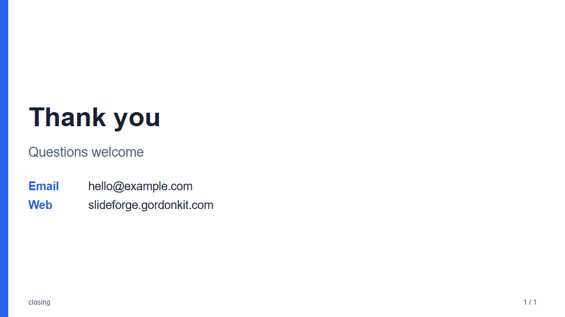 | 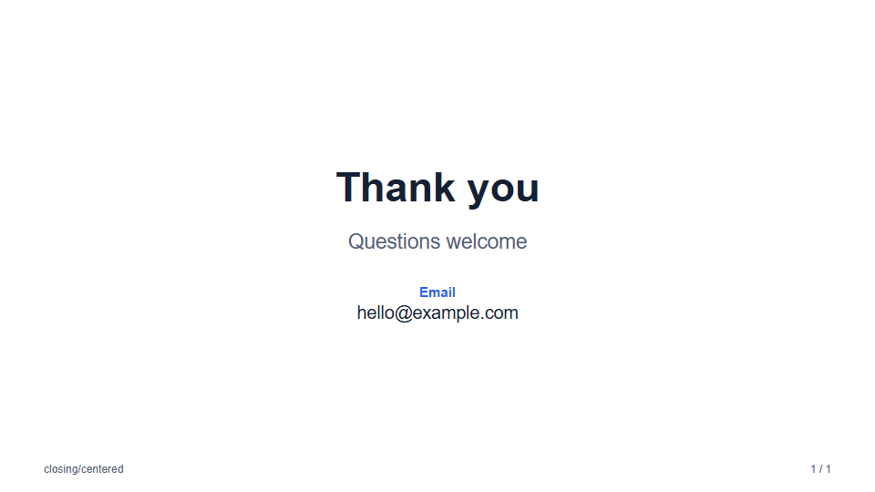 | 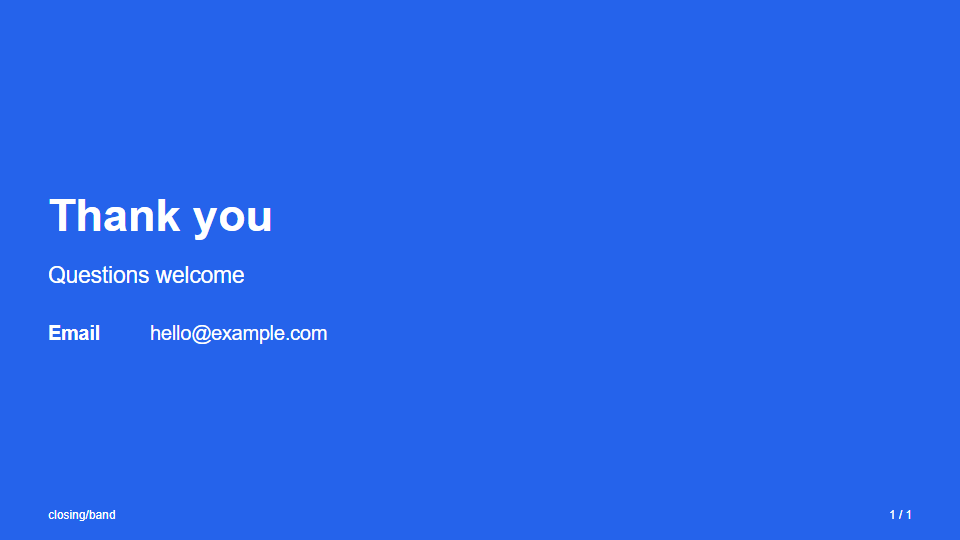 |

The variants match [section](layouts-structure.md#section): `default` has an accent rail, `centered` centers the text, and `band` fills the slide
with the accent color.

### `blank`

A blank slide shows only its background, here a
[Math Background Studio](backgrounds.md) design. Without a background it is an empty
slide in the theme's color.

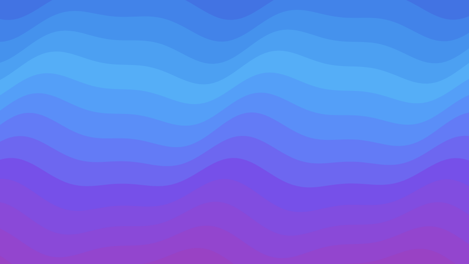
