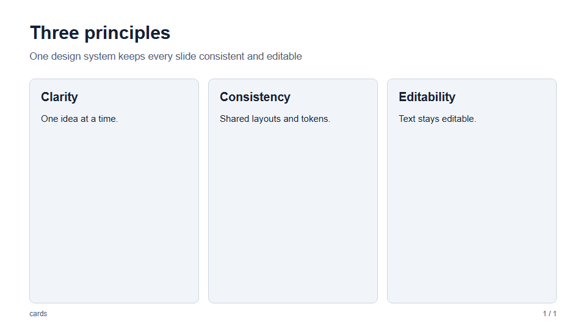

# JSON schema reference

The executable schema is [`src/schemas/presentation.ts`](../src/schemas/presentation.ts),
implemented with Zod. `parsePresentation(input: unknown)` validates and returns
the normalized `Presentation`, or throws a Zod validation error.
`describePresentationError(error)` turns that error into one line per problem with
its path and one-based slide number, and `readPresentationFile(path)` reads JSON
with a file-named syntax error; the CLI and preview use both. All objects,
including nested content/card/chart/metadata objects, are **strict**: unknown
keys are errors. There is no separate generated JSON Schema file.
All content strings must contain valid XML characters: tab/newline/carriage
return and valid Unicode XML ranges are accepted; forbidden control characters
and unpaired surrogates are rejected before PPTX generation.

## Presentation

| Field | Required | Type and constraints |
| --- | --- | --- |
| `metadata` | Yes | Object described below |
| `template` | No | Built-in template name, or a `./`/`../` path to a template; see [templates](templates.md#using-a-template) |
| `theme` | No | `"light"` or `"dark"`; default `"light"` |
| `fontFamily` | No | Trimmed nonempty string, max 200 characters; local font names with Unicode letters/numbers, spaces, commas, quotes, hyphens only |
| `backgrounds` | No | Object described under [Backgrounds](#backgrounds) |
| `slides` | Yes | Array of 1–200 slides |

`fontFamily` is a family/fallback list, not a CSS declaration or font URL.
Example: `"Noto Sans TC, Arial, sans-serif"`. It does not install or embed fonts.

### Metadata

| Field | Required | Type and constraints |
| --- | --- | --- |
| `title` | Yes | Trimmed nonempty string, max 300 |
| `author` | No | String, max 10,000 |
| `subject` | No | String, max 10,000 |
| `lang` | No | Language-tag-shaped string; default `"en"` |

`lang` matches `/^[a-z]{2,8}(?:-[a-z0-9]{1,8})*$/i`, for example `en`, `en-US`,
or `zh-Hant`. This is a syntactic check, not a language registry lookup.

## Common slide fields

Every slide requires `layout` and `title`.

| Field | Type and constraints |
| --- | --- |
| `layout` | A layout family below, or `family/variant`; see [Layout names](#layout-names) |
| `title` | Trimmed nonempty string, max 300 |
| `subtitle` | Optional string, max 10,000; a one-line takeaway under the title, see [Subtitle](#subtitle) |
| `footer` | Optional string, max 10,000 |
| `notes` | Optional string, max 10,000; emitted as hidden presenter-note markup, exported as PowerPoint speaker notes, and shown with N in `preview` and presentation mode |
| `background` | Optional background source, or `"none"`; see [Backgrounds](#backgrounds) |

Optional strings may be empty and are not trimmed. Required text fields are
trimmed and must remain nonempty. Schema maxima are data limits, **not promises
that content will fit a slide**; check rendered layout separately.

## Display text and font sizes

All authored display-text fields accept either the existing string or a strict
`{ "text": "...", "fontSize": ... }` object. `fontSize` is optional; without it,
the object renders exactly like the string. Each field's existing text length,
trimming, whitespace, and XML-character constraints also apply to `text`.

```json
{
  "layout": "content",
  "title": { "text": "Delivery", "fontSize": 56 },
  "subtitle": { "text": "A focused first phase", "fontSize": { "delta": -3 } },
  "blocks": [{ "type": "paragraph", "text": { "text": "Scope first.", "fontSize": { "delta": 4 } } }]
}
```

- A finite numeric `fontSize` is an absolute size in **CSS pixels**, 8–240,
  independent of the template. Decimals are accepted; 1 CSS pixel exports as 0.5 pt.
- `{ "delta": -4 }` or `{ "delta": 4 }` subtracts/adds CSS pixels from the
  field's normal size: template role token, then any variant/count scaling,
  then delta. It does not accumulate parent adjustments. Deltas must be finite
  and between -232 and 232; rendering rejects a resolved size outside 8–240.
- For example, default card body 30px with delta -4 is 26px; a hexagon's
  0.8 scale makes it 20px. A template changing card body to 40px makes those
  36px and 28px. Fixed-size roles (such as stat values) retain their layout base.
- Supported fields include slide title/subtitle/footer/author, paragraphs and
  bullet items, card/panel/quadrant titles, stats value/label/labelDetail/text,
  agenda titles/text/subsections, comparison labels/items, team name/role/text,
  process/hub/timeline/gantt labels, table columns/cells, chart labels/unit,
  image captions, quote/attribution, code/language, and contact label/value.
- Metadata, notes, layout names, URLs/paths, alt text, colors, numeric data,
  and generated slide/section numbers stay in their original formats.
  Numeric strings such as `"28px"` or `"+4"`, arbitrary CSS, and extra keys
  are rejected. Text remains escaped plain text, not Markdown/HTML or rich runs.

The field tables below describe the underlying text constraints. This shared
format applies to display-text fields even where their type is listed as string.
Changing font size does not resize the fixed canvas, line spacing, or containers;
review layout before export. See [design tokens](design-tokens.md).

## Subtitle

`subtitle` is the slide's one-line highlight or slogan: a sentence under the title that tells the
reader the point of the page before they read the content. The title names the topic
(`Three principles`); the subtitle states the takeaway (`One design system keeps every slide
consistent and editable`).



- **Where it works:** every layout except `blank`, which rejects `subtitle`. On other layouts it is
  drawn in the accent color, in semibold, after a short accent bar, so it reads as a highlight rather
  than as a caption. On `cover` it is the larger tagline in the muted color, without the bar.
- **Length:** keep it to one line, about 80 characters in English or 45 in Chinese or Japanese. The
  header has a fixed height, so a long subtitle wraps and the overflow is clipped. Say the point,
  not a paragraph.
- **Export:** the text is its own editable PowerPoint text box under the title, and the bar is an
  editable rectangle.
- **Styling:** a template adjusts it with the `type.subtitle` (size) and `spacing.subtitle` (gap)
  tokens; see [Design tokens](design-tokens.md).
- **Optional:** omit it where the title says enough. Using it on every slide dilutes it; use it on
  the slides whose message a skimming reader should not miss.

## Layout names

A `layout` value names a **family**, which decides the slide's fields, and
optionally a **variant** of it, which decides only how the slide is drawn:
`"cover"` or `"cover/default"`. A variant never adds or removes fields, so changing
it does not change the content. A bare family name is drawn as its `default`
variant, so `"<family>"` and `"<family>/default"` render the same.

| Family | Variants |
| --- | --- |
| `cover` | `default` (left-aligned), `centered` (centered title, subtitle, and author), `split` (accent panel on the right third; text and footer stay left of it), `band` (full-bleed accent block behind the title and subtitle, which use the on-accent color) |
| `quote` | `default` (left-aligned beside an accent bar), `centered` (centered, without the bar) |
| `cards` | `default` (rectangular cards), `rounded` (larger corners and an accent outline), `badge` (a numbered accent circle above each centered card), `circle` (accent-filled round cards with a number), `hexagon` and `pentagon` (accent-filled regular polygons with a numbered circle; the card keeps the polygon's proportions and the shape is an editable freeform shape behind the text) |
| `panels` | `default` (side-by-side columns split by vertical lines), `rows` (stacked rows split by horizontal lines) |
| `agenda` | `default` (numbered cards), `chapters` (a large-number index of the top level only), `outline` (each chapter as a card with its subsections listed under it) |
| `section` | `default` (left-aligned beside an accent rail), `centered` (centered text), `band` (the whole slide in the accent color) |
| `media` | `default` (the image on the left), `right` (the image on the right), `full` (the image across the slide, the text below it) |
| `stats` | `default` (large figures over accent rules), `cards` (centered figures on cards) |
| `matrix` | `default` (four cards), `lines` (four open quadrants split by a cross) |
| `process` | `default` (steps in a row joined by arrows), `vertical` (steps stacked, joined by down arrows) |
| `code` | `default` (a light panel), `dark` (a dark panel) |
| `chart` | `default` (horizontal bars), `columns` (vertical columns), `donut` (a ring of shares with a legend) |
| `closing` | `default` (left-aligned beside an accent rail), `centered` (centered text), `band` (the whole slide in the accent color) |
| `content`, `two-columns`, `compare`, `team`, `hub`, `timeline`, `gantt`, `table`, `blank` | `default` |

[`examples/variants/presentation.json`](../examples/variants/presentation.json)
shows each cover variant. The `split` panel and `band` block are decorative
shapes in the accent color; with a slide background they are drawn over it.

The value is kept as written after parsing. An unknown variant of a known family
is reported with that family's valid names, such as
`Unknown quote variant. Use "quote", "quote/default", or "quote/centered"`.

## Layout-specific fields

| Family | Additional fields |
| --- | --- |
| `"cover"` | Optional `author` string, max 10,000; independent of metadata author |
| `"agenda"` | Optional `items`: 2–8 objects, each with trimmed nonempty `title` (max 200), optional `text` string, max 10,000, optional integer `slide` (1–200): the number of the slide the item links to, which must exist in the presentation, and optional `items`: 1–6 subsections, each with `title` (max 200) and optional `slide` (drawn by `agenda/outline`). Without `items` the agenda lists the `section` slides (2–8 needed). Optional integer `current` (1–8): the item to mark as the current chapter |
| `"section"` | No additional fields: `title` is the chapter's name and `subtitle` its one-line summary. Sections are numbered `01`, `02`, … in slide order |
| `"content"` | Required `blocks`: 1–12 content blocks |
| `"two-columns"` | Required `left` and `right`: each 1–12 content blocks |
| `"cards"` | Required `cards`: 1–6 objects, each with trimmed nonempty `title` (max 200) and `blocks` (1–12) |
| `"panels"` | Required `panels`: 2–7 objects, each with trimmed nonempty `title` (max 200), `blocks` (1–12), and an optional `color`, a six-digit hex color such as `"#2563eb"` that fills the panel |
| `"media"` | Required `image` (an image source) and `alt` (max 1,000, may be empty); optional `caption` and `blocks` (up to 6 content blocks, default none) |
| `"stats"` | Required `stats`: 2–6 objects, each with trimmed nonempty `value` (max 30), `label` (max 100), optional trimmed nonempty `labelDetail` (max 100), optional `text`, and optional boolean `highlight` |
| `"matrix"` | Required `quadrants`: exactly 4 objects (top left, top right, bottom left, bottom right), each with `title` (max 200) and `blocks` (1–12); optional `xAxis` and `yAxis` names (max 80) |
| `"compare"` | Required `options`: 2–4 objects, each with `title` (max 100), `items` (1–8 strings, max 200), optional `label` and optional boolean `highlight` |
| `"team"` | Required `members`: 2–6 objects, each with `name` (max 100) and optional `role`, `text`, and `image` (an image source) |
| `"process"` | Required `steps`: 2–6 objects, each with `title` (max 100) and optional `text` |
| `"hub"` | Required `center` (max 100) and `items`: 3–6 objects, each with `title` (max 100) and optional `text` |
| `"timeline"` | Required `events`: 2–6 objects, each with trimmed nonempty `date` (max 100) and `title` (max 200), and optional `text` string, max 10,000 |
| `"gantt"` | Required `periods` (2–12 trimmed nonempty strings, max 40 each) and `tasks` (1–8 objects, each with trimmed nonempty `label` (max 100), integer `start` and `end`, and optional `progress` from 0 to 100); optional finite numeric `barRadius`, 0–120 CSS px |
| `"table"` | Required `columns` (1–8 trimmed nonempty strings, max 200 each) and `rows` (1–14 arrays of 1–8 string cells, max 2,000 each); optional `columnWidths`: one numeric percentage per column, each greater than 0 and at most 100, summing to 100 |
| `"chart"` | Required `data` (1–10 `{ "label", "value" }` objects); optional `unit` string, max 40; optional `blocks` (0–4 content blocks, default `[]`) |
| `"quote"` | Required `quote`: trimmed nonempty string, max 1,000; optional `attribution` string, max 10,000 |
| `"code"` | Required `code` (1–3,000 characters, at most 18 lines, kept as written); optional `language` label (max 60) |
| `"closing"` | Optional `contacts`: up to 4 objects, each with `label` (max 60) and `value` (max 200) |
| `"blank"` | None; `subtitle` and `footer` are rejected |

Every table row must contain exactly one cell per column. Empty table cell
strings are allowed. Tables have equal-width columns unless `columnWidths` is
set, for example `"columnWidths": [35, 10, 55]`. Percentages are numbers, not
strings such as `"35%"`; decimals are accepted, with a sum tolerance of 0.000001
percentage points for floating-point arithmetic. The HTML uses a `colgroup`;
narrow columns can wrap more text, so review the table height as well as widths.
Chart labels are trimmed, nonempty, max 100 characters;
values must be finite, nonnegative numbers. Zero is valid. Chart units are
appended directly to values; include a leading space for a separated suffix.
Charts are single-series HTML/CSS bars, not native Office charts.
When chart `blocks` are present, they form a right-hand explanation column
beside the bars (2:1 chart/explanation proportions); an empty array keeps a
full-width chart. A quote is plain text drawn larger than body text, vertically
centered in the content region; keep it to a few lines, since longer quotes clip.

Cards are arranged by their count: one spans the width, two sit side by side, three
and six use three columns, four form a 2 × 2 grid, and five are three over two, with the lower two keeping the upper cards' width and centered.
Agenda items are numbered `01`, `02`, … in array order, one row each (two columns from five items). An item with a `slide` is a link: see [Agenda](layouts-structure.md#agenda). A long deck is split into chapters with `section` slides; see [Section](layouts-structure.md#section).
Timeline events are drawn left to right in equal columns on one rail, in array order;
`date` is any short marker such as `2026`, `Q3`, or `Step 1`. Keep `text` to a line or
two, especially with five or six events.

A gantt slide is a project schedule: `periods` label equal columns (months, weeks,
sprints), and each task's bar spans the periods from `start` to `end`, both
one-based and inclusive, so `end` must not exceed the number of periods and `start`
must not be after `end`. With `progress`, the bar's first part (that percentage of
its length) is drawn in the accent color, the rest in the border color, and the
percentage is shown beside the label; without it the bar is solid accent.

Gantt `barRadius` overrides the corner radius of that slide's task bars and
background tracks only. For example, `"barRadius": 12` gives 12px corners;
`0` explicitly selects square corners. Omitted values continue using the
template's `tokens.border.radius`. Decimals are accepted, but strings such as
`"12px"` are rejected. Other slides and the template are unchanged. Progress
fills retain their proportions and are clipped by the rounded outer bar.
CSS limits oversized radii to the available dimensions.

A blank slide draws only its background: no title, content, footer, or slide number.
Its required `title` names the slide (its accessible label) but is not drawn, and
`notes` still become speaker notes. Without a background it is an
empty slide in the theme's color. See [Backgrounds](#backgrounds) and the
[Math Background Studio guide](backgrounds.md).

## Content blocks

The `type` discriminator selects one of:

```json
{ "type": "paragraph", "text": "One clear idea." }
```

`text` is a trimmed nonempty string. There is no explicit maximum for paragraph
text; visual layout still limits usable length.

```json
{ "type": "bullets", "items": ["First", "Second"], "ordered": false }
```

`items` contains 1–12 trimmed nonempty strings; there is no explicit per-item
maximum. `ordered` defaults to `false`.

```json
{
  "type": "image",
  "src": "assets/diagram.svg",
  "alt": "Diagram explaining the workflow",
  "caption": "Optional caption"
}
```

`src` is trimmed, nonempty, max 2,000,000 characters; `alt` is required, max
1,000 (empty allowed); `caption` is optional, max 10,000. Allowed image sources:

- HTTP(S) URLs with a hostname and no username/password.
- Base64 `data:image/png`, `jpeg`, `gif`, `webp`, or `avif` URLs.
- Relative/path URLs with no explicit URI scheme and not beginning `//`.
  Local SVG files work via a path; SVG data URLs are not accepted.

Whitespace/control characters and backslashes are rejected in `src`; use URL
encoding where appropriate. `file:`, `javascript:`, and other explicit schemes
are rejected. Path-style values beginning `/` can pass the schema but resolve
from the origin/filesystem root, so prefer portable relative paths.

These restrictions are not a network sandbox or path confinement policy.
Use trusted sources.

### Remote images

SlideForge downloads HTTP(S) images itself, in Node, for `export`, `preview`,
`present`, and `build --embed-assets`, so the image host's CORS and
`Cross-Origin-Resource-Policy` headers do not matter. A plain `build` still
leaves the URL in the HTML for the browser to load. The URL must return the
image itself:

- SVG, PNG, JPEG, GIF, WebP, or AVIF, decided from the bytes. A
  `Content-Type` that names a different type is an error; a missing or generic
  (`application/octet-stream`) type is accepted.
- At most 25 MiB per image and 200 MiB per deck, 30 seconds per request, and 5
  redirects. No cookies or credentials are sent, so the file must be public.
- Errors name the slide and the cause: a web page instead of an image, an HTTP
  error, an unsupported or mismatched type, too large, a timeout, or too many
  redirects.

Share links from file hosts usually open a web page, not the file. For a public
Google Drive file (tested in October 2026):

| URL form | Works |
| --- | --- |
| `https://drive.google.com/file/d/<ID>/view?usp=sharing` (the share link) | No: a web page; the error suggests the form below |
| `https://lh3.googleusercontent.com/d/<ID>` | Yes, also in a plain `build`; not a documented Google endpoint, so it may change |
| `https://drive.google.com/uc?export=view&id=<ID>` | Yes when SlideForge downloads it; a plain `build` shows a broken image, because the host sends `Cross-Origin-Resource-Policy: same-site` |

OneDrive and SharePoint share links also open a web page, and their download
links carry expiring tokens or need a sign-in; download the file and use a local
path. For Dropbox, change `dl=0` to `raw=1`. For decks that must be
reproducible, prefer local files next to the JSON.

`--block-private-network` (or `SLIDEFORGE_BLOCK_PRIVATE_NETWORK=1`, the default in
the container image) refuses images on loopback, private, link-local, and other
non-public addresses, including after redirects; during export it also refuses
the browser's requests to them. See the [CLI reference](cli.md#remote-images).

## Backgrounds

A background fills the whole slide behind its content. Each slide uses the first
that is set:

1. the slide's own `background`;
2. `backgrounds["<family>/<variant>"]` for the variant it is drawn with;
3. `backgrounds.<family>` for its family;
4. `backgrounds.default`.

A bare family name is drawn as `default`, so `backgrounds["cover/default"]` also
applies to `"layout": "cover"` slides. A slide with `"background": "none"` has no
background even when the presentation sets one, and shows the theme's slide color.
`backgrounds` is a strict object whose optional keys are `default`, every family
name, and every `family/variant` name. Each value, and a slide's `background`, is a background source:

- An image source with the same rules as the `image` block's `src`. It is drawn
  with `object-fit: cover`, so an image that is not 16:9 is cropped, not stretched.
- A [Math Background Studio](https://bg.gordonkit.com/studio) share link, copied
  from the studio's Share button (see the [step-by-step guide](backgrounds.md)): `https://bg.gordonkit.com/studio#d=…`. The
  design is drawn by the studio's `/render` page for the slide's 1920 × 1080
  size. Links from `http://localhost`, `127.0.0.1`, or `[::1]` on any port are
  also accepted for a local studio development server. A `/studio` or `/render`
  link with `#d=` from any other host, or from plain `http://bg.gordonkit.com`,
  is rejected.

```json
{
  "metadata": { "title": "Backgrounds" },
  "backgrounds": {
    "default": "assets/plain.svg",
    "cover": "https://bg.gordonkit.com/studio#d=1PYo…",
    "chart": "assets/grid.png"
  },
  "slides": [
    { "layout": "cover", "title": "Cover uses backgrounds.cover" },
    {
      "layout": "content",
      "title": "Its own",
      "background": "assets/photo.jpg",
      "blocks": [{ "type": "paragraph", "text": "…" }]
    },
    {
      "layout": "table",
      "title": "None",
      "background": "none",
      "columns": ["A"],
      "rows": [["1"]]
    }
  ]
}
```

`slideBackground(presentation, slide, template?)` returns the resolved source, or
`undefined`. A [template](templates.md#precedence) adds its own `backgrounds` and
`variants` to this lookup. Backgrounds are exported as raster PowerPoint slide backgrounds;
see [architecture](architecture.md#slide-backgrounds) and
[limitations](limitations.md#backgrounds).

## Minimal complete input

```json
{
  "metadata": { "title": "Team update", "lang": "en" },
  "theme": "light",
  "slides": [
    {
      "layout": "content",
      "title": "This week",
      "blocks": [
        { "type": "paragraph", "text": "The first milestone is complete." },
        { "type": "bullets", "items": ["Review", "Refine", "Export"] }
      ],
      "notes": "Discuss the next milestone."
    }
  ]
}
```

For one slide of every layout family and multilingual content, use
[`examples/basic/presentation.json`](../examples/basic/presentation.json) or the
CLI `init` command.
