# Templates

A template is the look of a presentation, kept apart from its content: palettes,
a font family, design token overrides, backgrounds, and each layout family's
variant. The same presentation JSON can be drawn with different templates.

The executable schema is [`src/templates/schema.ts`](../src/templates/schema.ts).
`parseTemplate(input)` validates a template and throws a Zod error; like the
presentation schema, every object is strict. A template is data only: it cannot
add CSS, HTML, scripts, layout families, or variants.

## Fields

| Field | Required | Type and constraints |
| --- | --- | --- |
| `name` | Yes | Lowercase letters, digits, and hyphens, starting with a letter; max 64 |
| `description` | No | String, max 10,000 |
| `palette` | No | `{ light?, dark? }`; each a partial palette (below) |
| `fontFamily` | No | Same rules as the presentation's `fontFamily` |
| `tokens` | No | Numeric design token overrides by group (below) |
| `backgrounds` | No | Same keys and sources as the presentation's [`backgrounds`](schema.md#backgrounds) |
| `variants` | No | Family → variant to draw that family's bare-name slides with |

```json
{
  "name": "corporate",
  "palette": {
    "light": { "accent": "#f5a524", "onAccent": "#0b1f3a" },
    "dark": {
      "background": "#0b1f3a",
      "accent": "#f5a524",
      "onAccent": "#0b1f3a"
    }
  },
  "fontFamily": "Noto Sans TC, Arial, sans-serif",
  "tokens": {
    "type": { "title": 64 },
    "border": { "radius": 0 }
  },
  "backgrounds": { "cover/band": "assets/band.png" },
  "variants": { "cover": "band" }
}
```

### Palette

`palette.light` and `palette.dark` override the built-in
[palette](design-tokens.md#color) of the same name with six-digit hex colors for
any of `background`, `foreground`, `muted`, `accent`, `onAccent`, `surface`,
`border`, `canvas`, and `outline`. The presentation's `theme` still chooses which palette is
used; a template does not choose the theme.

### Tokens

`tokens` has optional `layout`, `spacing`, `type`, `border`, and `chart` groups.
Each group accepts only that group's numeric tokens from
[the token reference](design-tokens.md#exported-token-groups-and-css-names), in
CSS pixels at the 1920 × 1080 canvas. String tokens (line heights and the bold
weight) are fixed.

| Group | Allowed range |
| --- | --- |
| `layout`, `chart` | 0–1920 |
| `spacing` | 0–480 |
| `type` | 8–240 |
| `border` | 0–120 |

After merging, the layout tokens must keep the canvas geometry:

- `padding-top + header + content + padding-bottom` equals 1080, so changing
  `header` means changing `content` by the opposite amount;
- `padding-top + cover-header + cover-content + padding-bottom` is at most 1080;
- `cover-top` is at most `cover-header`;
- `footer-bottom + footer` is at most `padding-bottom`;
- `2 × padding-x + cover-panel` is less than 1920.

These checks keep the regions on the slide; they do not prove content fits. A
smaller content region or larger type clips sooner, so review layout issues
after export as usual.

### Title outline

`tokens.border["title-outline"]` (0–4, default 0) strokes slide and cover titles
in the palette's `outline` color, for titles over a busy background:

```json
{
  "name": "poster",
  "palette": { "light": { "outline": "#ffffff" } },
  "tokens": { "border": { "title-outline": 2 } }
}
```

The stroke is centered on the glyph edges and drawn over the fill, in HTML and
PowerPoint alike, so half of it covers the glyph: at 6 px, a 90 px bold Arial
stem kept only half of its fill. 2–3 px suits Latin and CJK titles; wider strokes
fill in dense CJK characters, so the token stops at 4. PowerPoint text outlines
cannot sit outside the glyph only, so `paint-order` is not used. Export writes it as a
native PowerPoint text outline; see [limitations](limitations.md#text-outlines).

### Variants

`variants` maps a family to one of its [variants](schema.md#layout-names). A slide
whose `layout` is a bare family name (`"cover"`) is drawn with the template's
variant; a slide that names one (`"cover/default"`) keeps it.

## Precedence

| Setting | Highest to lowest |
| --- | --- |
| Palette | template `palette[theme]` entries, then the built-in palette for `theme` |
| Font family | presentation `fontFamily`, template `fontFamily`, built-in default |
| Tokens | template `tokens`, built-in tokens |
| Variant | variant named in the slide's `layout`, template `variants[family]`, `default` |
| Background | slide `background`; then `family/variant`, family, and `default` keys, where each presentation `backgrounds` entry replaces the template's entry with the same key |

For example, a template with `backgrounds.cover` and a presentation with only
`backgrounds.default` still draws covers with the template's cover background.

## Built-in templates

Besides `default`, these templates ship with the package. Each one overrides both
palettes; choose the look with `template` and the palette with `theme`:

```json
{ "template": "indigo-midnight", "theme": "dark" }
```

| Template | Light accent | Dark accent | Suited to |
| --- | --- | --- | --- |
| `indigo-midnight` | `#4f46e5` | `#60a5fa` | Professional and tech-leaning: product and engineering decks |
| `forest-emerald` | `#15803d` | `#34d399` | Calm and natural: sustainability, education, health |
| `ocean-violet` | `#0e7490` | `#a78bfa` | Clean data reports (light, teal) and a creative dark mode (violet) |
| `corporate` | `#b45309` | `#f5a524` | Navy and amber, square corners, banded cover |
| `terracotta-graphite` | `#c2410c` | `#fbbf24` | Warm brand stories (light) and polished keynotes (graphite and amber, dark) |
| `sunset-orange` | `#cf450a` | `#fb923c` | Energetic launches and pitches |
| `coffee-brown` | `#8b4513` | `#d4a373` | Editorial and heritage brands |
| `crimson-red` | `#c81e3a` | `#fb7185` | Urgent, confident, high-impact messages |
| `magenta-pink` | `#c026d3` | `#e879f9` | Playful, creative, youth-facing decks |

Light-theme accents keep at least about 4.5:1 contrast with the background, which is why
the orange, pink, and red light accents are deeper than their dark counterparts. SlideForge
does not check contrast; test your own colors.

Each screenshot is the same chart slide, so only the colors differ. Regenerate them with
`npm run docs:template-screenshots` after `npm run build`.

**`indigo-midnight`**

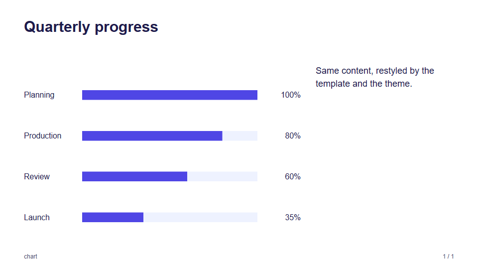
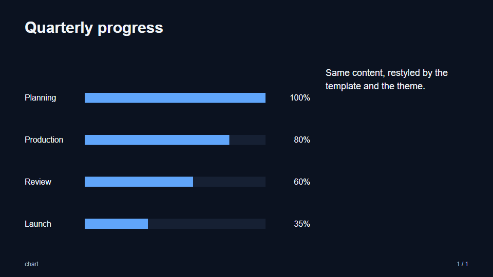

**`forest-emerald`**

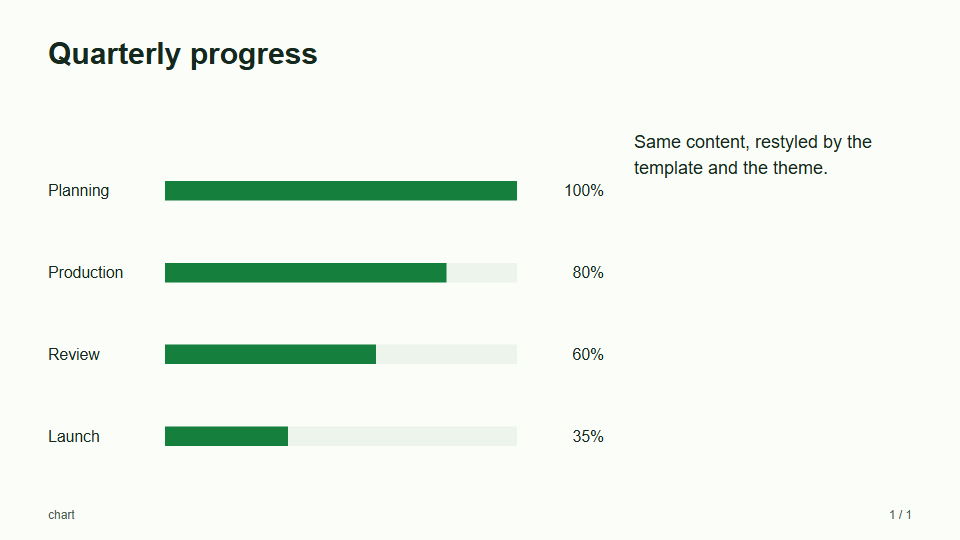
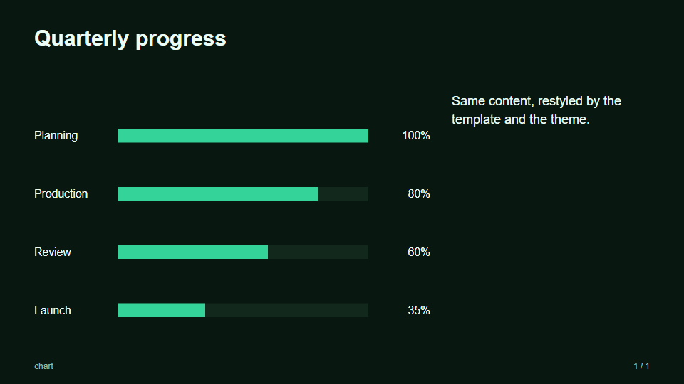

**`ocean-violet`**

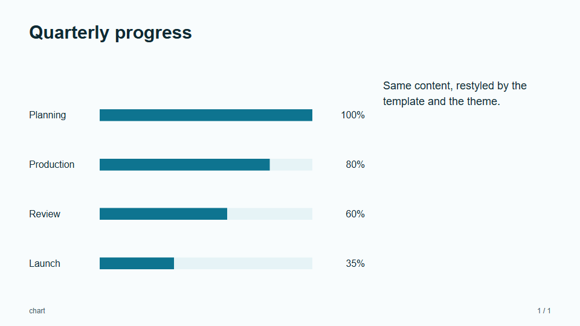
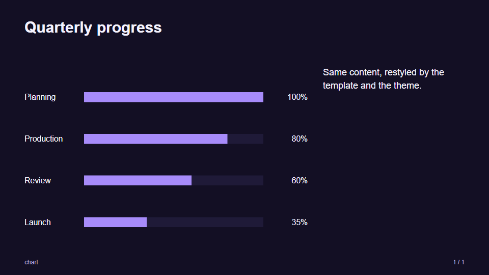

**`corporate`**

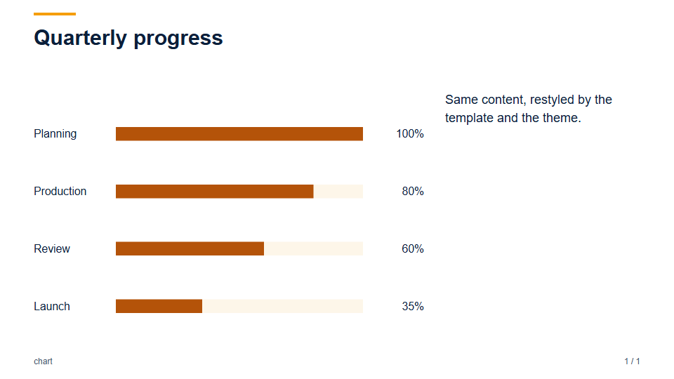
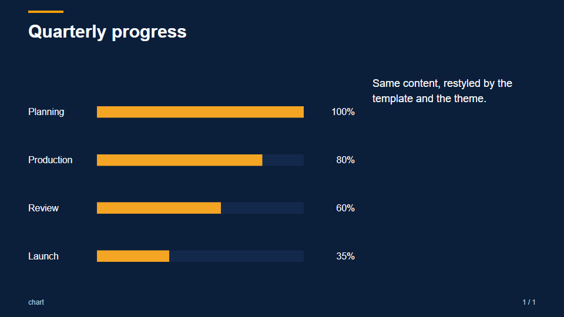

**`terracotta-graphite`**

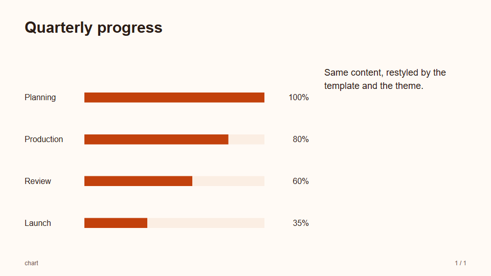
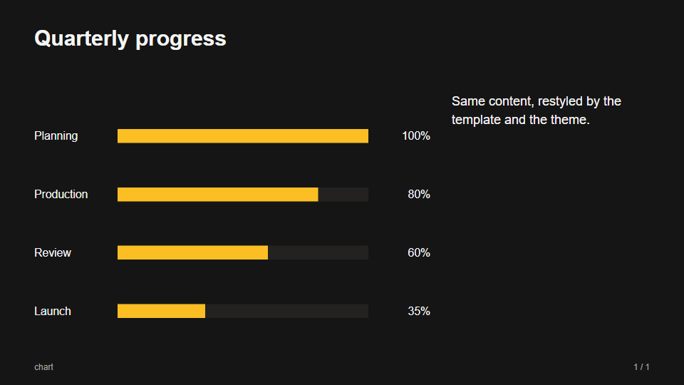

**`sunset-orange`**


**`coffee-brown`**

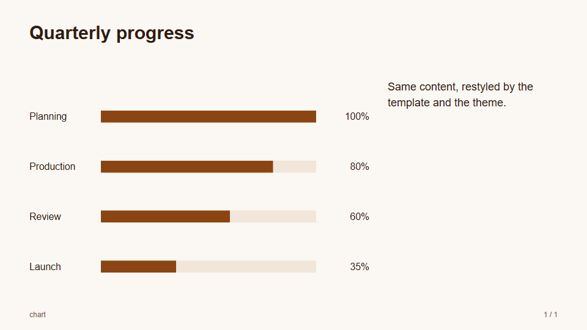
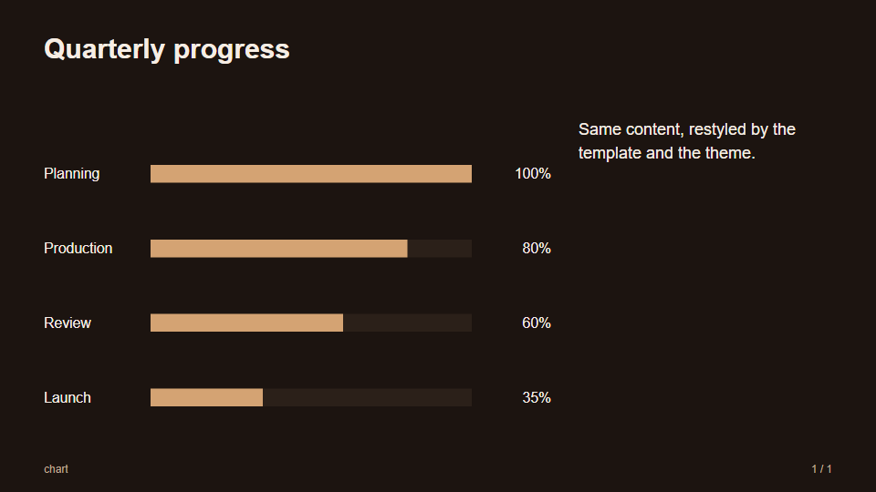

**`crimson-red`**

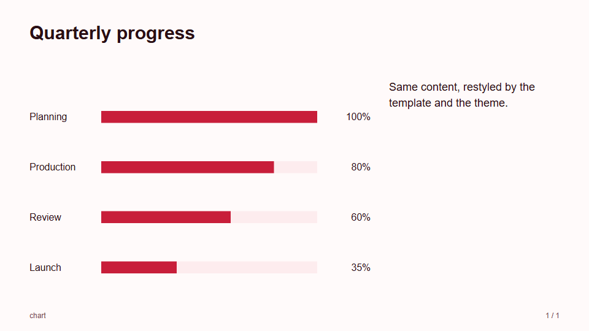
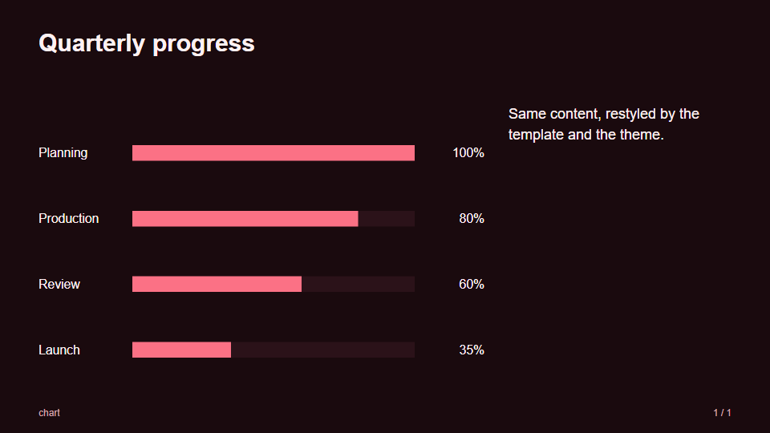

**`magenta-pink`**

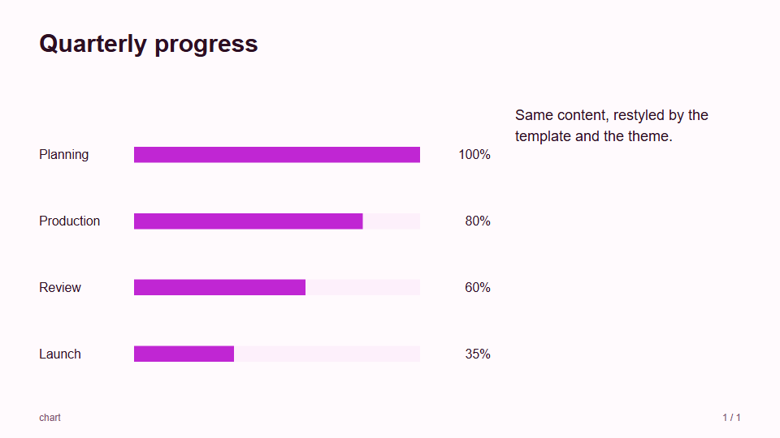
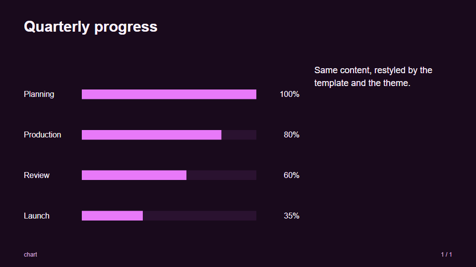

## Using a template

Name it in the presentation's `template` field:

```json
{
  "metadata": { "title": "Quarterly review" },
  "template": "corporate",
  "slides": [ … ]
}
```

The value is one of:

- a **built-in** template name: `default` (no overrides), `corporate` (navy and
  amber, square corners, `cover/band`, and an amber rule above each title), or one
  of the color templates under [Built-in templates](#built-in-templates). They
  ship in the package's `templates/` folder and in the container image;
- a **path** starting with `./` or `../`, relative to the presentation JSON's
  folder, to a template `.json` file or to a folder that holds `template.json`.
  Use forward slashes.

[`examples/templates/`](../examples/templates/) is a deck with its own template in
`brand/` (with an image in `brand/assets/`): bare `cover` and `quote` slides take
the template's variants, and the last slide names `cover/band` to override it.
Change its `"template"` to `"corporate"` or `"default"` to restyle the same
content:

```sh
node dist/cli/index.js preview examples/templates/presentation.json
```

`build`, `preview`, and `export` read the template with the presentation;
`init --template <name|./path>` writes the field into a new starter deck after
checking that the template loads. A missing, unknown, malformed, or invalid
template fails with a message naming it; schema problems are listed one per line,
like the presentation's.

### Template assets

A template's relative background sources resolve against **the template's own
folder**, so a template can carry its images: `"default": "assets/rule.svg"` in
`brand/template.json` means `brand/assets/rule.svg`. For `build` and `export` the
rendered HTML refers to them by absolute `file:` URL, so built HTML is tied to
the machine that built it. `preview` serves the template folder's images
(`.svg`, `.png`, `.jpg`, `.jpeg`, `.gif`, `.webp`, `.avif` only) under
`/@slideforge/template/` and reloads when the template changes. In the container,
a local template must be inside the `/work` mount like the deck.

### From code

`loadPresentation(file)` reads a presentation JSON file and the template it names,
returning `{ content, template? }`, where `template` is `{ template, file,
directory }`. `fileRenderOptions(file, loaded)` turns that into
`renderPresentation` options with the file's and template's folders as base URLs:

```js
import {
  fileRenderOptions,
  loadPresentation,
  renderPresentation,
} from './dist/index.js';

const file = 'deck/presentation.json';
const loaded = await loadPresentation(file);
const options = fileRenderOptions(file, loaded);
const html = renderPresentation(loaded.content, options);
```

`renderPresentation(input, { template, templateBaseUrl })` takes a template object
directly. `templateBaseUrl` is the absolute HTTP(S)/file URL its relative
background sources resolve against; without it they resolve against the document.
Rendering a presentation that names a template without passing one throws, since
`renderPresentation` does not read files. `loadTemplate(reference, fromFolder)`
and `builtInTemplates()` are also exported.
